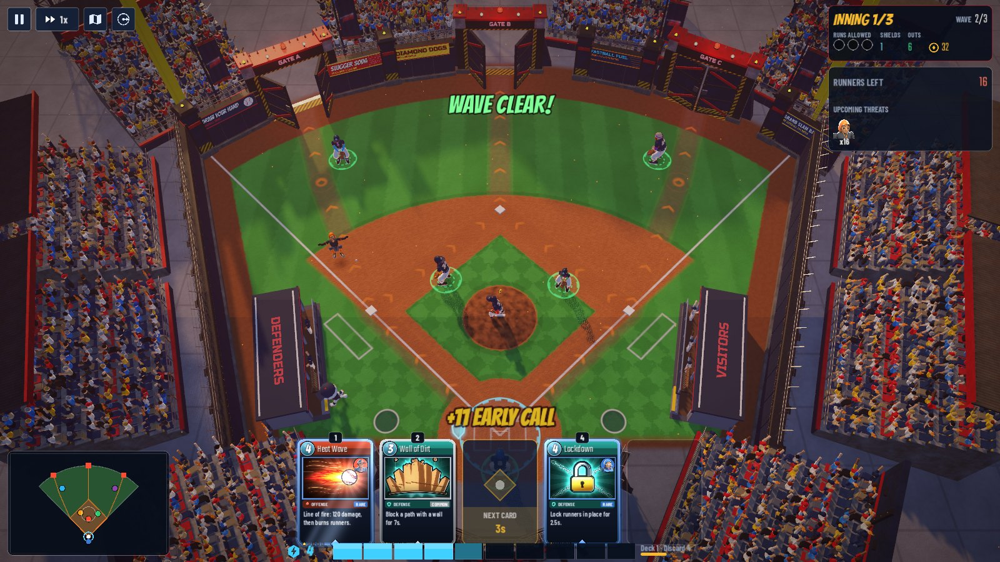
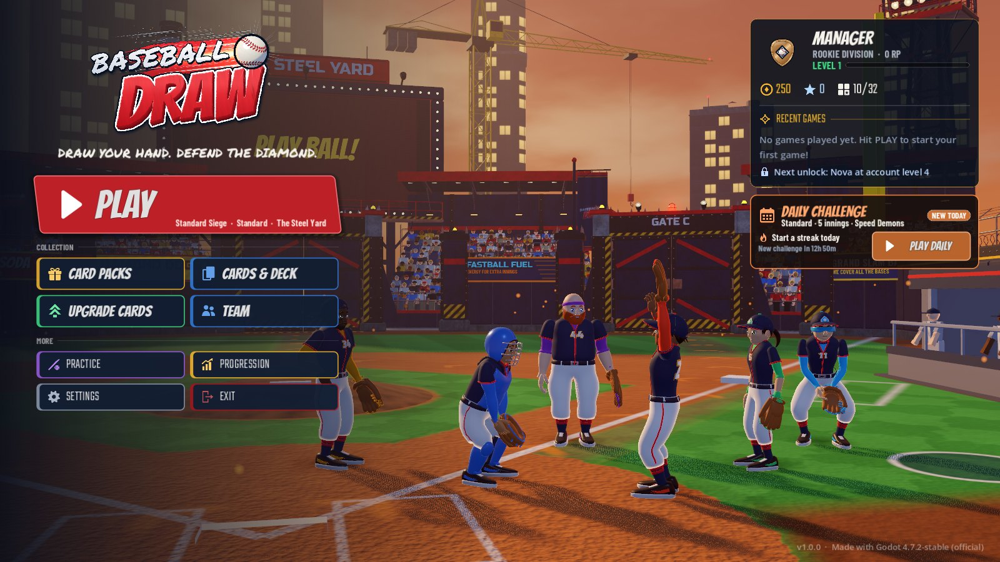
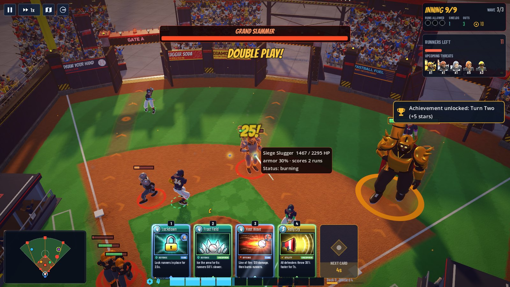
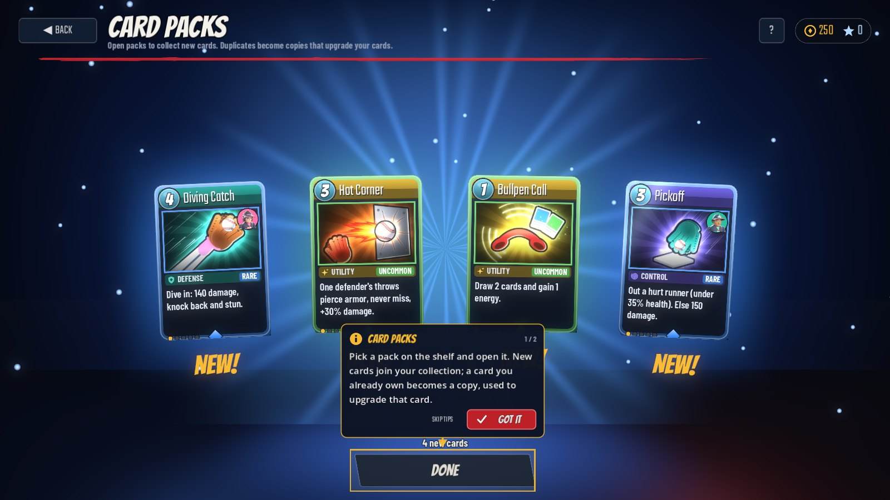
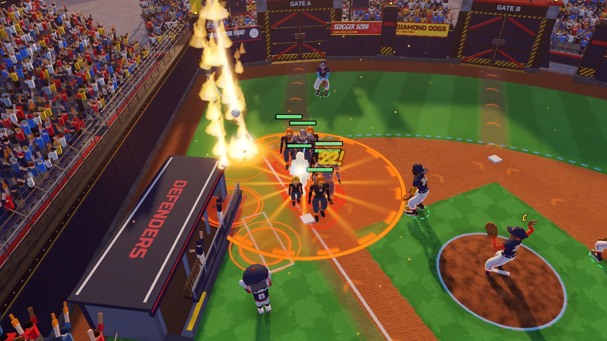
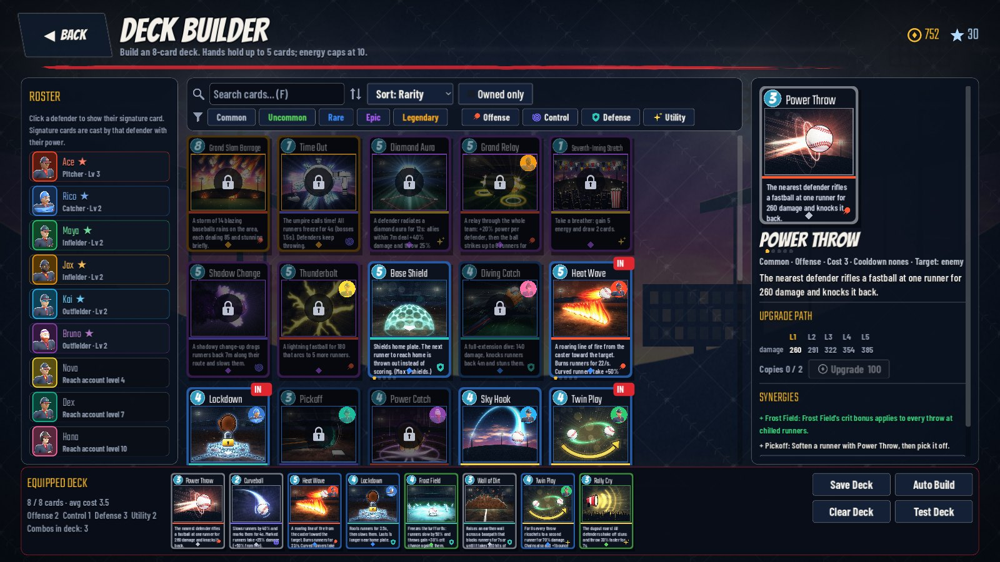
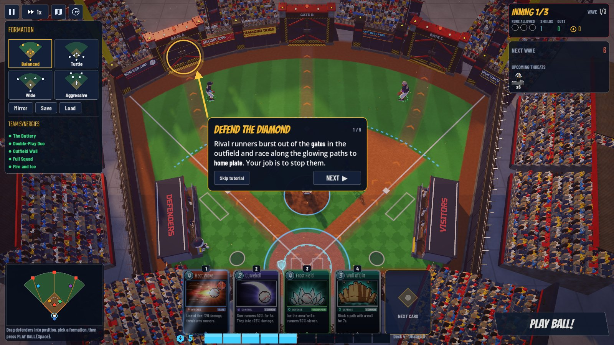

# BASEBALL DRAW

**Draw your hand. Defend the diamond.**

Baseball Draw is a 3D baseball tower-defense deckbuilder for Windows PC, built with Godot 4.7.
Command six fictional baseball defenders on a fortified stadium diamond, position them tactically,
and play ability cards to stop waves of rival runners — and their bosses — from reaching home plate.



| | |
|---|---|
|  |  |
|  |  |
|  |  |

All screenshots are rendered by the game itself (`tools/capture_screenshots.sh`); more in `docs/screenshots/`.

## Features

- **Real 3D stadiums** — six arenas (The Steel Yard, Sunset Grounds, Neon Diamond, Iron Fortress,
  Frostpark, Champion's Citadel) with fortress walls, enemy gates, light towers, animated crowds,
  a live scoreboard, waving banners and themed skylines.
- **Nine rigged and animated defenders** (Ace, Rico, Maya, Jax, Kai, Bruno + unlockable Nova, Dex, Hana),
  each with a class trait, a signature card, levels, training traits, gear and team uniforms.
- **Eight runner types and three bosses** — Runner, Sprinter, Armored, Swarmer, Jumper, Trickster,
  Captain and Siege Slugger; bosses Iron Slugger, Phantom Captain and the Grand Slammer, all with
  telegraphed attacks and counterplay.
- **26 ability cards** in four categories (offense, control, defense, utility) and five rarities,
  with real combos (Curveball + Heat Wave, Magnet Glove + Grand Slam Barrage, Twin Play + relays...).
  8-card decks, 5-card hand, 10 energy, cooldowns, draw/discard cycling. Every card has a one-line rule,
  bold painted art and a metallic frame with a glow in its rarity colour; Rare, Epic and Legendary cards
  have an animated foil finish. A card that can't be played shakes and says why.
- **Card packs** are how you collect cards: Rookie, Pro and Champion packs (with guaranteed rarities) and
  Signature packs for new defenders. Earn them by finishing games and levelling up, or buy them in the
  pack shop. Each pack has its own design and opening: the foil pack charges up and tears open, the cards
  fan out face down with a glow in their rarity colour, and flip when clicked. Pro, Champion and Signature
  packs add light rays, lightning arcs, particle spirals and confetti, and Epic and Legendary pulls get an
  extra build-up. Duplicates become upgrade copies, spent in the **Upgrade Cards** screen.
- **Guided first game**: pop-up tips walk new players through the field, outs and runs, moving defenders,
  starting a wave and playing a card, with extra tips for the first run scored, the dugout and the first
  boss.
- **Positioning matters** — zone bonuses (pitcher on the mound, catcher behind the plate, infielders in the dirt,
  outfielders on the grass), team synergies, captain auras and four formation presets plus custom formations.
- **Between-innings dugout** with run upgrades (Stronger Arm, Faster Relay, Wider Coverage, New Pitch Card,
  Base Shield, Captain's Rally...) in round steps and round prices, each showing what it does now and next,
  plus discounted specials.
- **Defender level road**: defenders earn XP from every game (more for outs and for the MVP), and every level
  up to 10 pays out coins, a new trait or a card pack. The results screen shows each XP bar filling.
- **Modes**: Standard Siege (9 innings, 3 bosses), Quick Defense (3 innings), The Endless Ninth
  (survival with modifiers and milestones), Practice Field (sandbox) and Promotion Challenges for the
  offline rank ladder (Rookie → Bronze → Silver → Gold → Platinum → Diamond → Champion → Legend).
- **Long-term progression**: account level, defender XP/levels, card collection and upgrades, card packs,
  gear shop, uniforms, 28 achievements, stadium unlocks, records and match history.
- **Four difficulties** (Rookie, Standard, Veteran, Legend) that change runner toughness, speed, wave size,
  enemy ability timing, elite affixes, starting shields and rewards.
- **Settings**: resolution, window mode, V-Sync, FPS cap, UI scale, quality presets (shadows, AA, SSAO,
  glow, volumetric fog, particles, crowd density, FSR render scale), separate master/music/effects/ambience/UI
  volume, damage numbers, screen shake, auto-start waves, accessibility options and full key rebinding.
- **Saves**: atomic JSON saves with automatic backup recovery; runs autosave at every inning boundary so
  "Continue Run" resumes where you left off.

## How to play

1. On your first launch, press **Play the first game**: a short Quick Defense on Rookie with step-by-step
   tips. (Later: **PLAY → Quick Defense** is the best ten-minute game.)
2. Before the first pitch, **drag defenders** around the field or pick a formation. A green ring under a
   defender means they are in their best zone. Watch the glowing routes — runners follow them from the
   outfield gates to home plate.
3. Press **Space** (or PLAY BALL!) to start a wave. Defenders throw automatically.
4. **Play cards** with **1–5** (or by clicking them), then click a target. Cards cost energy, which refills
   during waves. Signature cards are cast by their defender.
5. Every runner you stop is an **out**; every runner that reaches home scores a **run** against you.
   Allow too many runs (3 on Standard) and the game is over. Base Shields stop one run each.
6. Between innings, spend run coins in **the dugout**. At the end of a run you earn coins, XP, rank points
   and **card packs** — open them from the results screen or **CARD PACKS** in the main menu, then put new
   cards into your deck in **CARDS & DECK** (new cards are marked NEW). Duplicates level cards up in
   **UPGRADE CARDS**.

### Controls

| Control | Action |
|---|---|
| WASD / arrow keys | Pan camera |
| Mouse wheel | Zoom |
| Left click | Select defender / drag to reposition / cast card |
| Right click | Cancel targeting or drag, deselect |
| 1–5 | Select the card in that slot (press again to cast at the cursor when it is over the field) |
| Q / E | Previous / next playable card |
| Space | Begin next wave (early calls earn bonus coins) |
| Shift | Fast-forward (1x → 2x → 3x) |
| R | Rotate camera |
| Tab | Cycle defenders |
| F | Show all defender ranges |
| M | Tactical (top-down) map |
| C | Center camera |
| Enter | Confirm / start wave |
| Esc | Pause / back |

Keyboard bindings can be changed in **Settings → Controls**. Click the minimap to move the camera.

## Running the game

### Windows build

The **Build Baseball Draw** GitHub Actions workflow imports the project, runs the automated tests and exports
the game. It runs on pushes to `main`, on `v*` tags, on any push whose commit message contains `[build]`, and on
demand (repository *Actions* tab → *Build Baseball Draw* → *Run workflow*). Download the `BaseballDraw-Windows`
artifact from the run, unzip it and run `BaseballDraw.exe` (keep `BaseballDraw.pck` next to it).
A Linux build is produced too.

### From source

1. Install [Godot 4.7.2](https://godotengine.org/download) (standard build).
2. Open `project.godot` in Godot and press **F5**, or run `godot --path .` from the repository root.
3. To export yourself: install the 4.7.2 export templates, then
   `godot --headless --path . --export-release "Windows Desktop" build/windows/BaseballDraw.exe`.

Saves live in `%APPDATA%\BaseballDraw` on Windows (`~/.local/share/BaseballDraw` on Linux):
`profile.json` (+ `profile.bak` backup), `settings.cfg` and `controls.cfg`.

## Testing

```
tools/check_scripts.sh                    # parse/compile every script with autoloads loaded
godot --headless --path . res://tests/test_suite.tscn -- --profile=unittest --fresh-profile
xvfb-run godot --path . -- --ui-test --profile=uitest --fresh-profile     # simulated mouse/keyboard flows
tools/simulate.sh standard standard 2     # autopilot games for balance (add --no-cards)
tools/shot.sh out.png 15 --test-battle=quick --auto --profile=test        # in-engine screenshot
tools/capture_screenshots.sh              # re-render docs/screenshots/
godot --path . -- --perf-test --profile=perf                              # stress test / frame timings
```

See [docs/DEVELOPMENT_REPORT.md](docs/DEVELOPMENT_REPORT.md) for what was built and verified.

## Project layout

```
data/              JSON game data (cards, defenders, enemies, arenas, modes, upgrades, achievements...)
src/autoload/      DB, Settings, InputConfig, Profile (saves), Audio, Session, Router
src/core/          RunState, WaveGenerator, Rewards, test helpers
src/battle/        Battle orchestrator, field/stadium builders, defenders, enemies, projectiles,
                   card system and effects, zones, walls, traps, camera, autopilot
src/characters/    CharacterModel (rigged GLB wrapper)
src/ui/            Theme, HUD, menus, dugout, results, deck builder, roster, progression, settings
src/vfx/           Pooled particle/text/ring effects
assets/            Generated models, textures, audio, fonts and shaders
tools/             Asset generators (Blender, audio synth, 2D art) and test/sim scripts
tests/             Automated test suite and UI flow test
```

## Assets and credits

Every model, animation, texture, card illustration, icon, sound effect and music track in this repository
was generated procedurally by the scripts in `tools/` (Blender `bpy` for 3D, NumPy for audio,
Pillow/cairo for 2D art). Fonts are from Google Fonts under the SIL Open Font License / Apache License
(see `assets/fonts/`). Built with the [Godot Engine](https://godotengine.org) (MIT).
