# Baseball Draw — Development Report

This report describes what was built, how it was verified, and what is known to be limited.
Everything below was produced in a Linux container with no GPU; see *Testing environment* for what
that means for the numbers.

## 1. Engine and architecture

* **Engine:** Godot 4.7.2 (Forward+ renderer). Godot was chosen for its native 3D pipeline, glTF import,
  skeletal animation, GDScript iteration speed and straightforward Windows export.
* **Code:** ~13,000 lines of GDScript in `src/`, organised by responsibility:

| Area | Files |
|---|---|
| Core game state | `src/core/run_state.gd`, `src/autoload/session.gd` |
| Static data / database | `data/*.json`, `src/autoload/db.gd` |
| 3D field and stadium | `src/battle/field.gd`, `field_builder.gd`, `stadium_builder.gd`, `assets/shaders/*.gdshader` |
| Characters | `src/characters/character_model.gd` (GLB wrapper, surface merging, overlays) |
| Defender behaviour | `src/battle/defender.gd` |
| Enemy AI and bosses | `src/battle/enemy.gd`, `route.gd` |
| Projectiles | `src/battle/projectiles.gd` (pooled balls + ribbon trails) |
| Cards | `src/battle/card_system.gd`, `card_effects.gd`, `effect_zone.gd`, `dirt_wall.gd`, `bunt_trap.gd` |
| Waves / innings | `src/core/wave_generator.gd`, `src/battle/battle.gd` |
| Progression | `src/autoload/profile.gd`, `src/core/rewards.gd` |
| User interface | `src/ui/*` (theme, HUD, menus, dugout, results, deck builder, roster, progression, settings) |
| Save management | `src/autoload/profile.gd` (atomic JSON + backup), `settings.gd`, `input_config.gd` |
| Audio | `src/autoload/audio_manager.gd` (buses, pooling, rate limiting, music cross-fades) |
| VFX | `src/vfx/vfx.gd` (shared GPU particle systems driven by `emit_particle`, pooled text) |

* **Data-driven:** cards, defenders, enemies, upgrades, formations, difficulties, modes, arenas/layouts,
  achievements, gear, uniforms, ranks and card combos are JSON in `data/`. Adding a card means a JSON entry,
  art, and (for a new mechanic) a branch in `card_effects.gd`.

## 2. Assets (all procedurally generated, sources in `tools/`)

| Asset set | Generator | Output |
|---|---|---|
| 20 rigged, animated characters (9 defenders, 8 runners, 3 bosses) + portraits | `tools/blender/characters/` (Blender 5.2 `bpy`) | `assets/models/characters/*.glb`, `assets/textures/portraits/*.png` |
| 32 stadium props (walls, gates A–D, light towers, grandstands, scoreboard, dugout, banners, industry, skyline...) | `tools/blender/props/` | `assets/models/props/*.glb` |
| 65 sound effects, 7 music tracks, 2 ambience loops | `tools/audio/` (NumPy synthesis) | `assets/audio/` |
| Logo, 26 card illustrations, 65 icons, rank emblems, rarity gems, UI backgrounds, app icon | `tools/art/` (Pillow + cairo) | `assets/textures/` |

Detailed asset reports (dimensions, triangle counts, animation timings, loudness) are in `docs/asset_reports/`.
Characters share one 22-bone armature and one animation set (idle, ready, run, sprint, walk, throw, pitch,
catch, special, hit, stunned, defeat, celebrate, victory, leap, swing, slam, taunt). At load time each
character's 13–17 material surfaces are merged into a single vertex-coloured surface (uniform colours baked in,
cached per model) so a character costs one draw call; translucent surfaces (the Phantom Captain's cape) keep their
own material as a second surface. Clips are baked at 60 Hz so the gameplay events tied to them (ball release,
catch, bat impact, slam impact) land on exact frames; looping clips have identical first and last keys.

## 3. Implemented features

* **Battle:** procedural field shader (mowing stripes, infield dirt, chalk, warning track, worn routes with
  animated direction chevrons, placement-zone overlay); route following with rounded corners; defender
  targeting priorities (first/last/strongest/weakest/fastest/closest); throws released on the animation's
  release frame; accuracy vs evasion misses; crits; class traits (Fastball, Home Guard aura, Quick Hands +
  dash-tag, Cannon Arm pierce/knockback, Precision, Heavy Hitter splash/stun, Static Charge chain, Pickoff
  Artist, Gap Shooter); stuns from sluggers/bosses; zone bonuses; synergies; captain aura.
* **Runners:** slow/root/stun/freeze/confuse/knockback/burn/mark/chill/armor-break/magnet statuses;
  sprint bursts, leaps (ignore ground effects), trickster blinks and decoys, captain auras, slugger swings
  that stun defenders and smash walls; elite affixes on higher difficulties.
* **Bosses:** Iron Slugger (armour cracks after telegraphed ground slams), Phantom Captain (phases out,
  conjures decoys, aura), Grand Slammer (telegraphed home-run swings at defenders, summons reinforcements at
  66%/33%), each with a camera intro, boss bar and music change.
* **Cards:** all 26 cards implemented with distinct mechanics, energy costs, cooldowns, levels, linked-defender
  casting and combos. Targeting previews: area circle, Heat Wave line, runner/defender highlight, route snap.
* **Rules:** an out per runner stopped; runs when runners reach home (2–3 for captains, sluggers, bosses);
  run limit per difficulty (3 on Standard); Base Shields stop one run each; Double/Triple Play and Grand Slam
  combos; innings of 3 waves; early-call bonus; inning bonuses and clean-inning bonus.
* **Dugout** between innings with performance, next-inning scouting, team stats, six core upgrades plus two
  randomised specials (incl. defender-specific Hot Streak and the New Pitch Card choice).
* **Modes:** Standard Siege, Quick Defense, The Endless Ninth (random modifiers, boss every 3rd inning,
  milestones), Practice Field (spawn any runner, any card, swap in any defender, infinite energy) and
  Promotion Challenges for the ranked ladder.
* **Progression:** account XP/levels, defender XP/levels with training traits at levels 3/6/9, gear shop,
  uniforms bought with stars, card packs and card upgrades with copies + coins, 28 achievements, six stadiums
  with unlock conditions, records, match history, eight rank divisions.
* **Menus:** live 3D main menu (team lineup, playing catch, cinematic camera, profile panel), Play menu,
  Deck Builder / Collection (search, rarity/category filters, sort, compare, upgrade, synergies, Save / Auto
  Build / Clear / Test Deck), Roster with a 3D showcase stage, Progression, Settings, pause menu, results.
* **Saves:** atomic writes (temp file + rename), rolling backup, automatic restore of a corrupt save (the bad
  file is kept as `profile.corrupt.json`), schema merge for missing keys, sanitising of unknown ids; runs
  autosave at every inning boundary.

## 4. Verification

| Check | How | Result |
|---|---|---|
| Every script parses and compiles with autoloads | `tools/check_scripts.sh` | 49 scripts, 0 failures |
| System tests | `tests/test_suite.tscn` | 887 checks, 0 failures |
| Interactive flows through simulated mouse/keyboard | `tests/ui_flow_test.gd` | 51 checks, 0 failures |
| Full runs, all modes | autopilot (`--auto`), `tools/simulate.sh` | Standard, Quick, Endless, Practice completed; wins and losses both reached |
| Packaged build | Linux export of the same pack as Windows, autopilot game | Completed a Quick Defense win from the exported binary |
| Windows export | `--export-release "Windows Desktop"` | `BaseballDraw.exe` + `BaseballDraw.pck` produced |
| Final art in engine | `tools/capture_screenshots.sh` (15 scenes rendered by the game itself) | See section 7 |

The system suite covers data integrity (art for every card, signatures, layouts ending at home plate...),
save/load round trips, corrupt-save recovery, profile repair, card upgrades, gear and traits affecting stats,
level-based unlocks, achievements (awarded once), run-state JSON round trips including RNG state, wave
determinism and scaling, boss scheduling, rewards and promotion, placement rules, zone bonuses, synergies,
defenders damaging runners, Base Shields, and an execution check of every one of the 26 cards.

The UI flow test drags a defender, applies a formation, uses Tab/Space/1-5/right-click/Esc/Shift/A/M, casts a
card by clicking the field, finishes an inning, buys a dugout upgrade, starts the next inning, quits to the
menu, continues the saved run (inning, formation and positions restored) and opens and backs out of every
main-menu destination.

### Balance simulations (autopilot, fresh level-1 profile)

Balance was iterated in several rounds of simulated games. The first build was far too easy (both bots
won Standard Siege without allowing a run), so shields were changed to stop one run each, coin income
was cut, enemy scaling steepened, energy slowed, and bosses tuned individually. Final numbers:

| Mode / difficulty | Card-playing bot | No-cards bot |
|---|---|---|
| Standard Siege / Rookie | Won, 0 runs allowed | Won, 1 run allowed |
| Standard Siege / Standard | 1 win (all three bosses beaten), 1 loss in the 9th | Lost in the 9th |
| Standard Siege / Veteran | Lost in the 9th | — |
| Standard Siege / Legend | Lost in the 8th | — |
| Quick Defense / Standard | Won (easy by design: a three-inning build-testing mode) | Won |
| The Endless Ninth / Standard | Reached inning 13 | — |

The bot plays cards at sensible but unfocused targets (it does not save Time Out or Power Catch for bosses),
so a human player should do better. Permanent progression (defender levels, gear, card levels) makes later
runs easier, as intended.

## 5. Performance

Measured with `tests/perf_test.gd` (Practice Field stress test):

* **CPU (headless, no rendering):** ~7 ms average frame time with ~70 runners, six defenders, projectiles and
  five simultaneous area abilities; the battle logic itself costs ~2 ms of that.
* **Rendering load (1920×1080):** empty stadium ~830 draw calls / 0.5 M triangles; with 150 runners on the field
  ~1,470 draw calls / 1.9 M triangles (down from ~5,460 before character surface merging).
* GPU frame times could not be measured: the container has no GPU and renders with the Mesa lavapipe software
  rasteriser (~1–3 s per frame), which says nothing about real hardware. The draw-call and triangle counts are
  well within what a mid-range desktop GPU renders at 60 FPS at 1080p, and the Low/Medium presets cut
  shadows, SSAO, fog, particles, crowd density and render scale (FSR) further.

## 6. Known limitations

* No GPU was available, so real-hardware frame rates are estimated from draw calls, triangle counts and CPU
  timings rather than measured. The Windows `.exe` was exported but could not be launched here (no Windows);
  the identical game pack was run successfully through the Linux export.
* Characters are procedural sculpts with flat-coloured materials (no texture maps); faces are modelled
  geometry. Animations are keyframed procedurally; they read well at gameplay distance but are not motion-capture
  quality. There are no finger or face bones (fixed hand poses, no blinking) and no corrective shapes, so the crotch
  and shoulders stretch a little in wide stances and with the arm fully raised. Capes, hoods, scarves and the
  ponytail follow the spine rather than simulating cloth; at the end of `defeat` the bosses' capes dip into the
  ground, and shoe tips can dip 2–5 cm below the ground on single frames.
* Music and sound effects are synthesised; instruments and crowd voices are stylised approximations.
* The `.exe` does not embed the custom icon (that needs `rcedit` on the build machine); the window icon is set
  at runtime.
* Balance was tuned with a bot; it should be refined with human playtesting.

## 7. Screenshots

Rendered by the game itself with `tools/capture_screenshots.sh` (Godot under a virtual display, software
Vulkan, 1600×900, High preset). Gameplay shots come from autopilot games.

| | |
|---|---|
|  Main menu with the live 3D lineup |  Quick Defense, inning 1 |
| 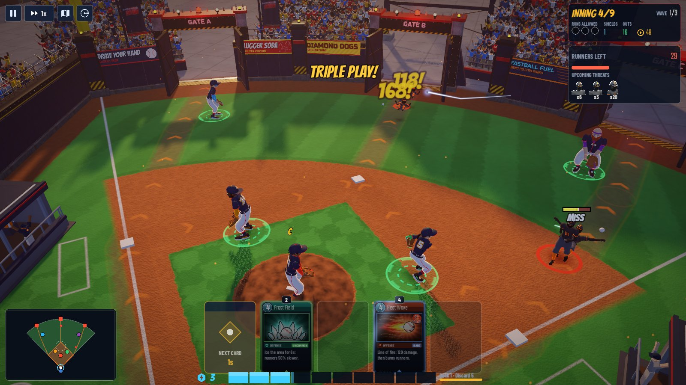 Mid-game, inning 4 |  Grand Slammer, inning 9 |
| 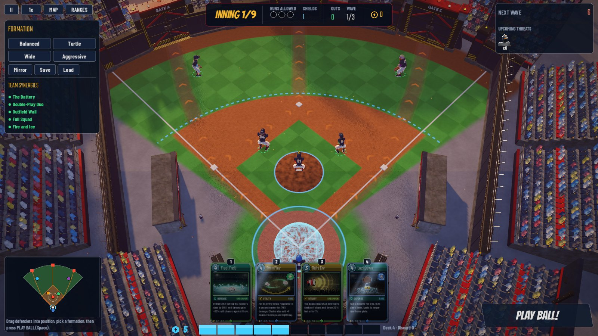 Setup phase: zones, routes, formation panel | 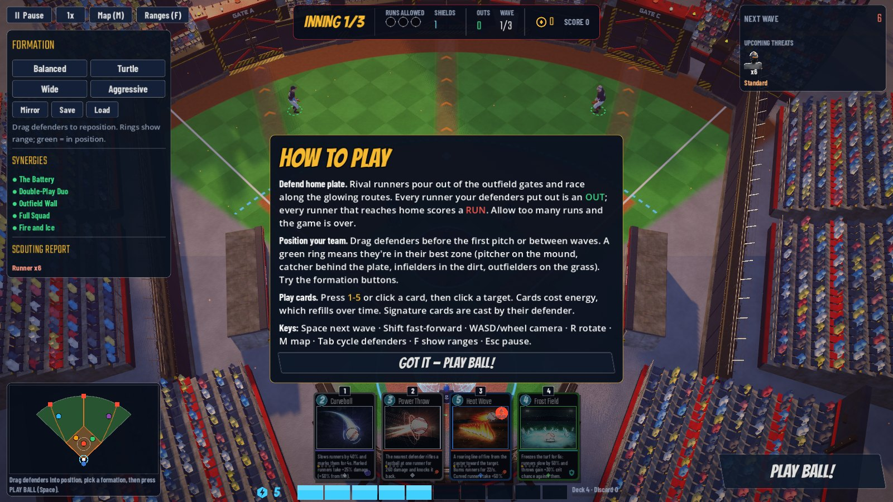 First-battle help panel |
| 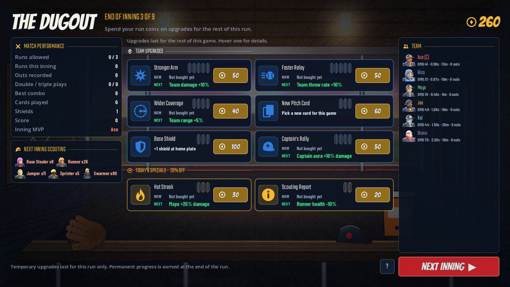 Between-innings dugout | 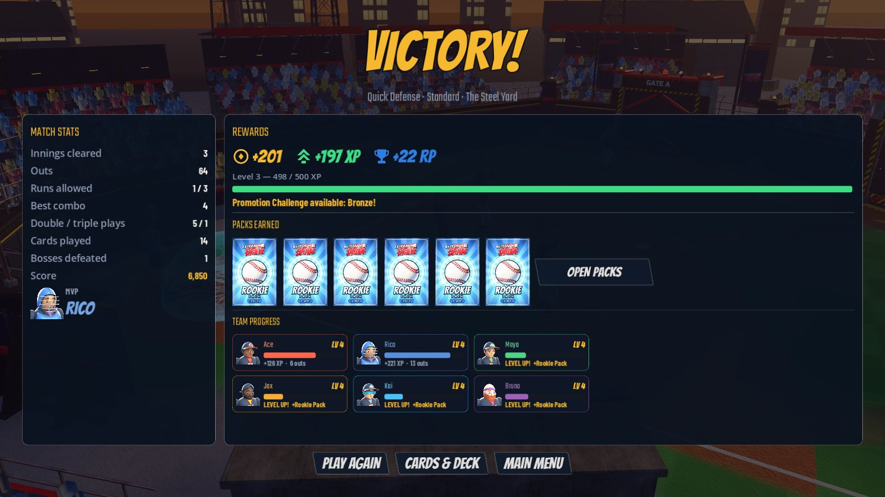 Results screen |
| 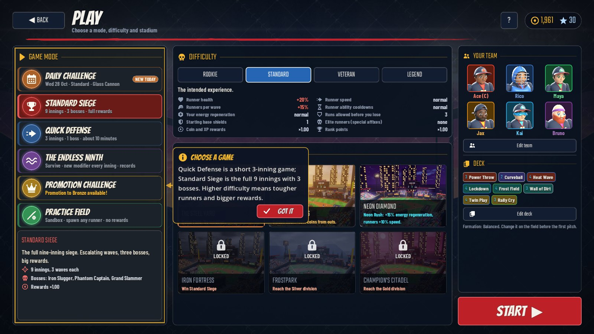 Play menu |  Deck builder |
| 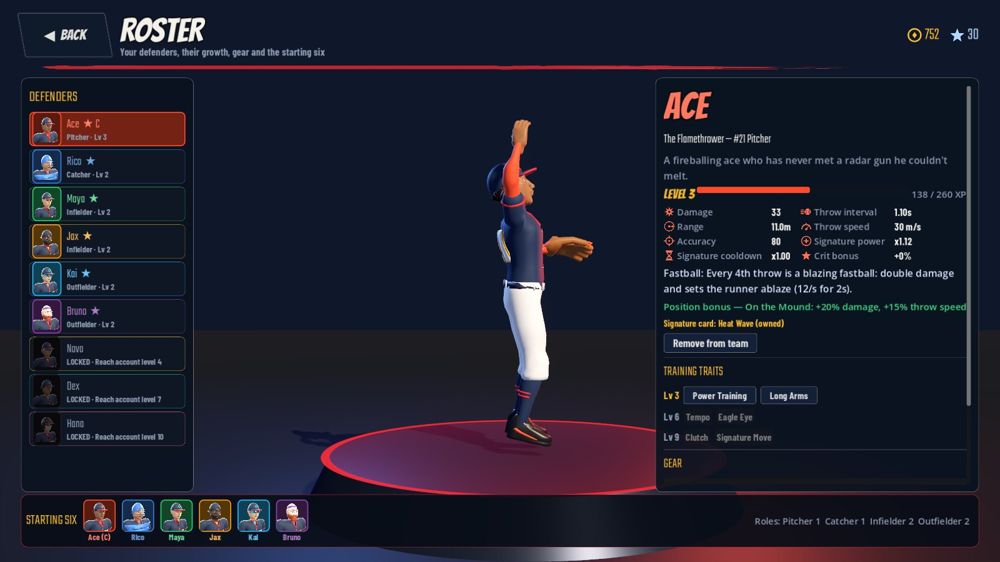 Roster with 3D showcase | 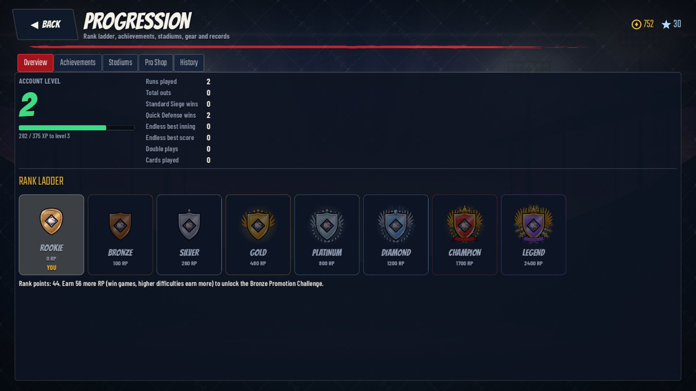 Progression |
| 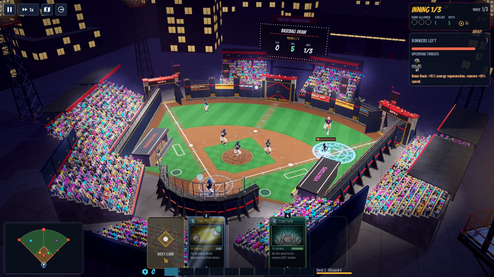 Neon Diamond | 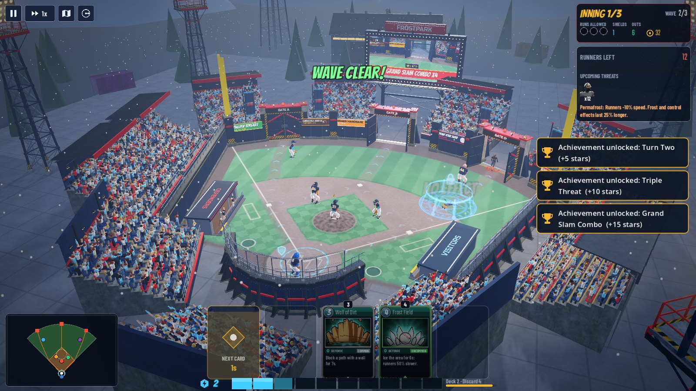 Frostpark |
| 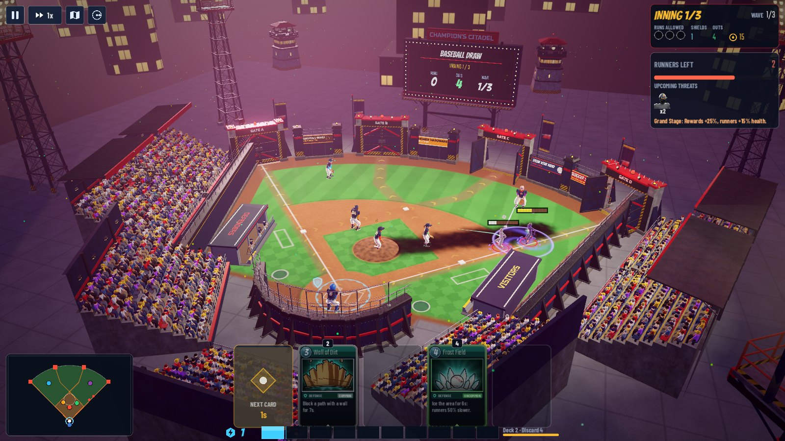 Champion's Citadel | |
