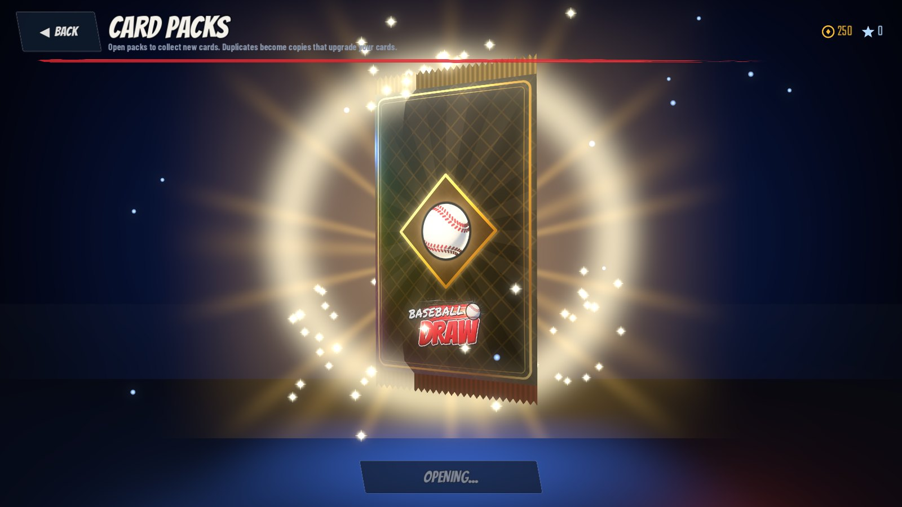
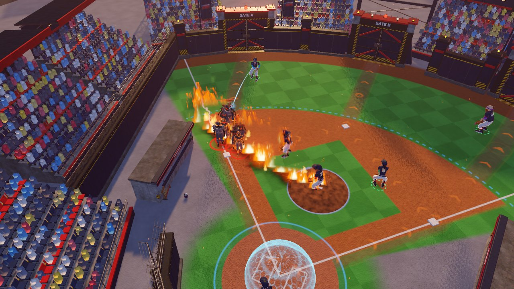
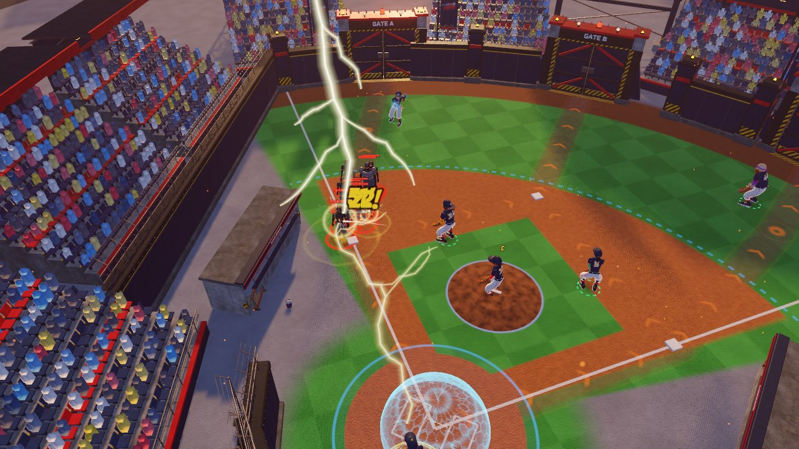
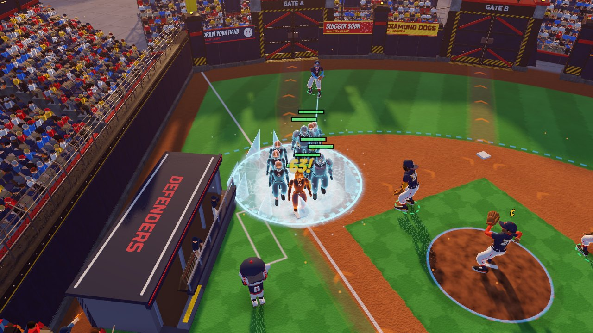
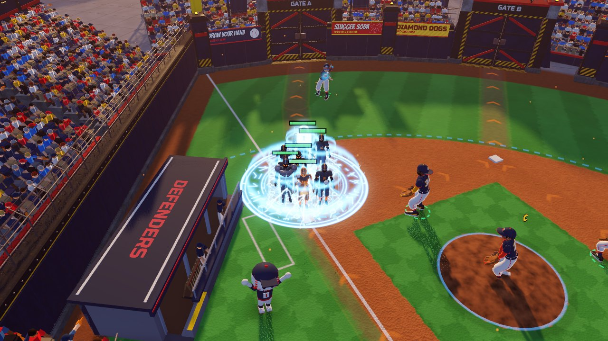
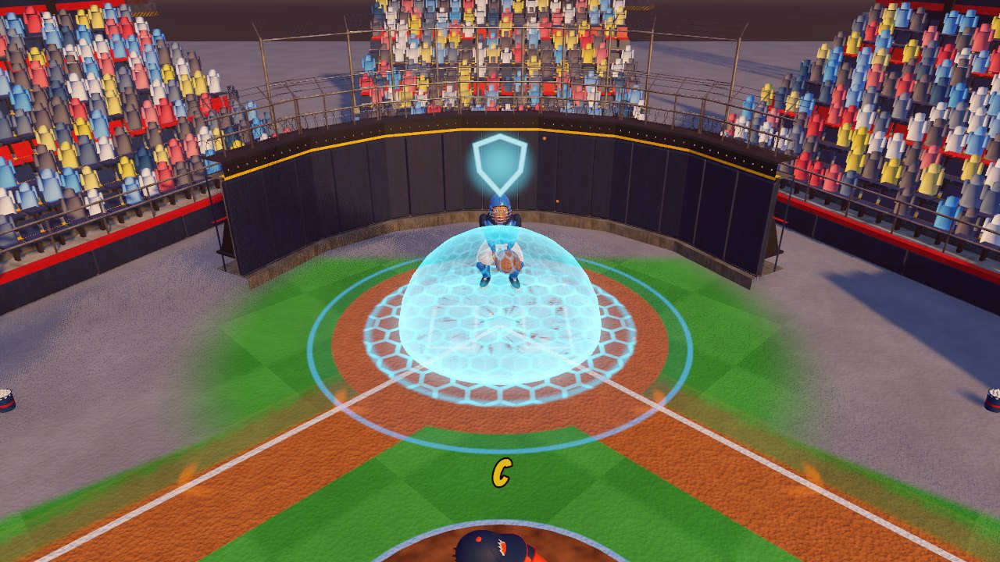
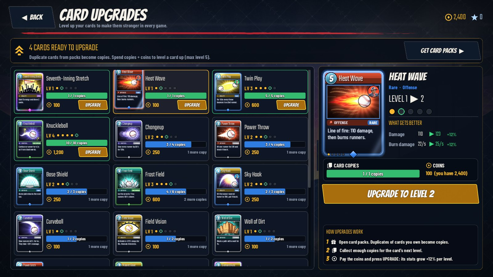
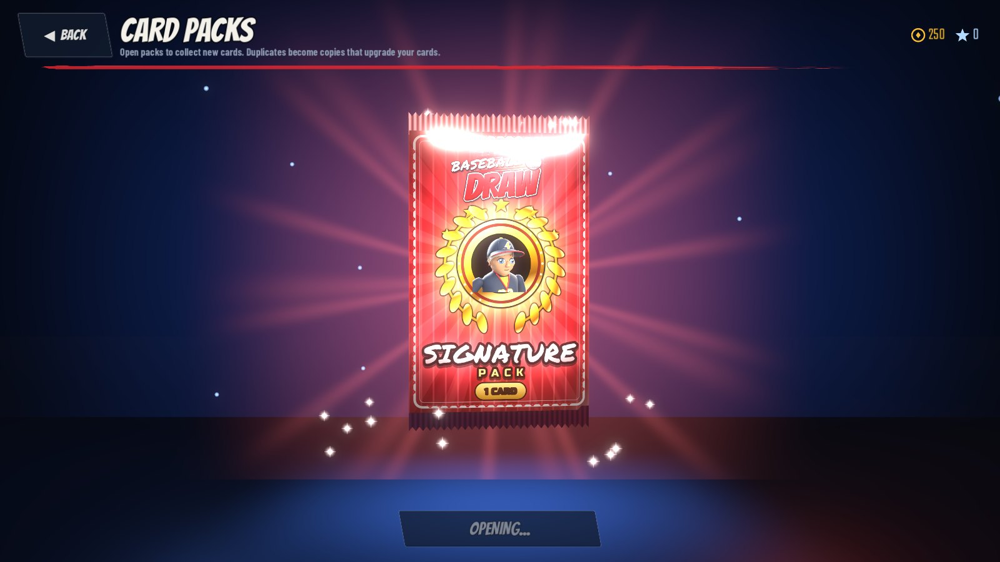

# Baseball Draw — Development Report

This report describes what was built, how it was verified, and what is known to be limited.
Everything below was produced in a Linux container with no GPU; see *Testing environment* for what
that means for the numbers.

## 1. Engine and architecture

* **Engine:** Godot 4.7.2 (Forward+ renderer). Godot was chosen for its native 3D pipeline, glTF import,
  skeletal animation, GDScript iteration speed and straightforward Windows export.
* **Code:** ~13,000 lines of GDScript in `src/`, organised by responsibility:

| Area | Files |
|---|---|
| Core game state | `src/core/run_state.gd`, `src/autoload/session.gd` |
| Static data / database | `data/*.json`, `src/autoload/db.gd` |
| 3D field and stadium | `src/battle/field.gd`, `field_builder.gd`, `stadium_builder.gd`, `assets/shaders/*.gdshader` |
| Characters | `src/characters/character_model.gd` (GLB wrapper, surface merging, overlays) |
| Defender behaviour | `src/battle/defender.gd` |
| Enemy AI and bosses | `src/battle/enemy.gd`, `route.gd` |
| Projectiles | `src/battle/projectiles.gd` (pooled balls + ribbon trails) |
| Cards | `src/battle/card_system.gd`, `card_effects.gd`, `effect_zone.gd`, `dirt_wall.gd`, `bunt_trap.gd` |
| Waves / innings | `src/core/wave_generator.gd`, `src/battle/battle.gd` |
| Progression | `src/autoload/profile.gd`, `src/core/rewards.gd` |
| User interface | `src/ui/*` (theme, HUD, menus, dugout, results, deck builder, roster, progression, settings) |
| Save management | `src/autoload/profile.gd` (atomic JSON + backup), `settings.gd`, `input_config.gd` |
| Audio | `src/autoload/audio_manager.gd` (buses, pooling, rate limiting, music cross-fades) |
| VFX | `src/vfx/vfx.gd` (shared GPU particle systems driven by `emit_particle`, pooled text) |

* **Data-driven:** cards, defenders, enemies, upgrades, formations, difficulties, modes, arenas/layouts,
  achievements, gear, uniforms, ranks and card combos are JSON in `data/`. Adding a card means a JSON entry,
  art, and (for a new mechanic) a branch in `card_effects.gd`.

## 2. Assets (all procedurally generated, sources in `tools/`)

| Asset set | Generator | Output |
|---|---|---|
| 20 rigged, animated characters (9 stylised defenders, 8 runners, 3 bosses) + portraits | `tools/blender/characters/` (Blender 5.2 `bpy`) | `assets/models/characters/*.glb`, `assets/textures/portraits/*.png` |
| 32 stadium props (walls, gates A–D, light towers, grandstands, scoreboard, dugout, banners, industry, skyline...) | `tools/blender/props/` | `assets/models/props/*.glb` |
| 73 sound effects (incl. pack shake/tear, card flip, rarity reveals), 7 music tracks, 2 ambience loops | `tools/audio/` (NumPy synthesis) | `assets/audio/` |
| 15 effect textures (glow, spark, smoke atlas, flame, scorch, crater, frost, runes, clock, web, chain...) | `tools/art/vfx/` (Pillow + NumPy) | `assets/textures/vfx/` |
| Logo, 26 card illustrations, 65 icons, rank emblems, rarity gems, UI backgrounds, app icon | `tools/art/` (Pillow + cairo) | `assets/textures/` |

Detailed asset reports (dimensions, triangle counts, animation timings, loudness) are in `docs/asset_reports/`.
Characters share one 22-bone armature and one animation set (idle, ready, run, sprint, walk, throw, pitch,
catch, special, hit, stunned, defeat, celebrate, victory, leap, swing, slam, taunt). At load time each
character's 13–17 material surfaces are merged into a single vertex-coloured surface (uniform colours baked in,
cached per model) so a character costs one draw call; translucent surfaces (the Phantom Captain's cape) keep their
own material as a second surface. Clips are baked at 60 Hz so the gameplay events tied to them (ball release,
catch, bat impact, slam impact) land on exact frames; looping clips have identical first and last keys.

## 3. Implemented features

* **Battle:** procedural field shader (mowing stripes, infield dirt, chalk, warning track, worn routes with
  animated direction chevrons, placement-zone overlay); route following with rounded corners; defender
  targeting priorities (first/last/strongest/weakest/fastest/closest); throws released on the animation's
  release frame; accuracy vs evasion misses; crits; class traits (Fastball, Home Guard aura, Quick Hands +
  dash-tag, Cannon Arm pierce/knockback, Precision, Heavy Hitter splash/stun, Static Charge chain, Pickoff
  Artist, Gap Shooter); stuns from sluggers/bosses; zone bonuses; synergies; captain aura.
* **Runners:** slow/root/stun/freeze/confuse/knockback/burn/mark/chill/armor-break/magnet statuses;
  sprint bursts, leaps (ignore ground effects), trickster blinks and decoys, captain auras, slugger swings
  that stun defenders and smash walls; elite affixes on higher difficulties.
* **Bosses:** Iron Slugger (armour cracks after telegraphed ground slams), Phantom Captain (phases out,
  conjures decoys, aura), Grand Slammer (telegraphed home-run swings at defenders, summons reinforcements at
  66%/33%), each with a camera intro, boss bar and music change.
* **Cards:** all 26 cards implemented with distinct mechanics, energy costs, cooldowns, levels, linked-defender
  casting and combos. Targeting previews: area circle, Heat Wave line, runner/defender highlight, route snap.
* **Rules:** an out per runner stopped; runs when runners reach home (2–3 for captains, sluggers, bosses);
  run limit per difficulty (3 on Standard); Base Shields stop one run each; Double/Triple Play and Grand Slam
  combos; innings of 3 waves; early-call bonus; inning bonuses and clean-inning bonus.
* **Dugout** between innings with performance, next-inning scouting, team stats, six core upgrades plus two
  randomised specials (incl. defender-specific Hot Streak and the New Pitch Card choice).
* **Modes:** Standard Siege, Quick Defense, The Endless Ninth (random modifiers, boss every 3rd inning,
  milestones), Practice Field (spawn any runner, any card, swap in any defender, infinite energy) and
  Promotion Challenges for the ranked ladder.
* **Progression:** account XP/levels, defender XP/levels with training traits at levels 3/6/9, gear shop,
  uniforms bought with stars, card packs and card upgrades with copies + coins, 28 achievements, six stadiums
  with unlock conditions, records, match history, eight rank divisions.
* **Menus:** live 3D main menu (team lineup, playing catch, cinematic camera, profile panel), Play menu,
  Deck Builder / Collection (search, rarity/category filters, sort, compare, upgrade, synergies, Save / Auto
  Build / Clear / Test Deck), Roster with a 3D showcase stage, Progression, Settings, pause menu, results.
* **Saves:** atomic writes (temp file + rename), rolling backup, automatic restore of a corrupt save (the bad
  file is kept as `profile.corrupt.json`), schema merge for missing keys, sanitising of unknown ids; runs
  autosave at every inning boundary.

## 4. Verification

| Check | How | Result |
|---|---|---|
| Every script parses and compiles with autoloads | `tools/check_scripts.sh` | 49 scripts, 0 failures |
| System tests | `tests/test_suite.tscn` | 922 checks, 0 failures |
| Interactive flows through simulated mouse/keyboard | `tests/ui_flow_test.gd` (incl. pack opening and the guided first game) | 73 checks, 0 failures |
| Full runs, all modes | autopilot (`--auto`), `tools/simulate.sh` | Standard, Quick, Endless, Practice completed; wins and losses both reached |
| Packaged build | Linux export of the same pack as Windows, autopilot game | Quick Defense won from the exported binary (3 innings, 0 runs, Iron Slugger beaten) |
| Windows export | `--export-release "Windows Desktop"` | `BaseballDraw.exe` (109 MB) + `BaseballDraw.pck` (43 MB) produced |
| Clean-machine build | GitHub Actions *Build Baseball Draw*: fresh import, script check, system suite, autopilot game, Windows + Linux export | Passing; builds downloadable as run artifacts |
| Final art in engine | `tools/capture_screenshots.sh` (15 scenes rendered by the game itself) | See section 7 |

The system suite covers data integrity (art for every card, signatures, layouts ending at home plate...),
save/load round trips, corrupt-save recovery, profile repair, card upgrades, gear and traits affecting stats,
level-based unlocks, achievements (awarded once), run-state JSON round trips including RNG state, wave
determinism and scaling, boss scheduling, rewards and promotion, placement rules, zone bonuses, synergies,
defenders damaging runners, Base Shields, and an execution check of every one of the 26 cards.

The UI flow test drags a defender, applies a formation, uses Tab/Space/1-5/right-click/Esc/Shift/A/M, casts a
card by clicking the field, finishes an inning, buys a dugout upgrade, starts the next inning, quits to the
menu, continues the saved run (inning, formation and positions restored) and opens and backs out of every
main-menu destination.

### Balance simulations (autopilot, fresh level-1 profile)

Balance was iterated in several rounds of simulated games. The first build was far too easy (both bots
won Standard Siege without allowing a run), so shields were changed to stop one run each, coin income
was cut, enemy scaling steepened, energy slowed, and bosses tuned individually. Final numbers:

| Mode / difficulty | Card-playing bot | No-cards bot |
|---|---|---|
| Standard Siege / Rookie | Won, 0 runs allowed | Won, 1 run allowed |
| Standard Siege / Standard | 1 win (all three bosses beaten), 1 loss in the 9th | Lost in the 9th |
| Standard Siege / Veteran | Lost in the 9th | — |
| Standard Siege / Legend | Lost in the 8th | — |
| Quick Defense / Standard | Won (easy by design: a three-inning build-testing mode) | Won |
| The Endless Ninth / Standard | Reached inning 13 | — |

The bot plays cards at sensible but unfocused targets (it does not save Time Out or Power Catch for bosses),
so a human player should do better. Permanent progression (defender levels, gear, card levels) makes later
runs easier, as intended.

## 5. Performance

Measured with `tests/perf_test.gd` (Practice Field stress test):

* **CPU (headless, no rendering):** ~7 ms average frame time with ~70 runners, six defenders, projectiles and
  five simultaneous area abilities; the battle logic itself costs ~2 ms of that.
* **Rendering load (1920×1080):** empty stadium ~830 draw calls / 0.5 M triangles; with 150 runners on the field
  ~1,470 draw calls / 1.9 M triangles (down from ~5,460 before character surface merging).
* GPU frame times could not be measured: the container has no GPU and renders with the Mesa lavapipe software
  rasteriser (~1–3 s per frame), which says nothing about real hardware. The draw-call and triangle counts are
  well within what a mid-range desktop GPU renders at 60 FPS at 1080p, and the Low/Medium presets cut
  shadows, SSAO, fog, particles, crowd density and render scale (FSR) further.

## 6. Known limitations

* No GPU was available, so real-hardware frame rates are estimated from draw calls, triangle counts and CPU
  timings rather than measured. The Windows `.exe` was exported but could not be launched here (no Windows);
  the identical game pack was run successfully through the Linux export.
* Characters are procedural sculpts with flat-coloured materials (no texture maps); faces are modelled
  geometry. Animations are keyframed procedurally; they read well at gameplay distance but are not motion-capture
  quality. There are no finger or face bones (fixed hand poses, no blinking) and no corrective shapes, so the crotch
  and shoulders stretch a little in wide stances and with the arm fully raised. Capes, hoods, scarves and the
  ponytail follow the spine rather than simulating cloth; at the end of `defeat` the bosses' capes dip into the
  ground, and shoe tips can dip 2–5 cm below the ground on single frames.
* Music and sound effects are synthesised; instruments and crowd voices are stylised approximations.
* The `.exe` does not embed the custom icon (that needs `rcedit` on the build machine); the window icon is set
  at runtime.
* Balance was tuned with a bot; it should be refined with human playtesting.

## 7. Screenshots

Rendered by the game itself with `tools/capture_screenshots.sh` (Godot under a virtual display, software
Vulkan, 1600×900, High preset). Gameplay shots come from autopilot games.

| | |
|---|---|
|  Main menu with the live 3D lineup |  Quick Defense, inning 1 |
|  Mid-game, inning 4 |  Grand Slammer, inning 9 |
|  Setup phase: zones, routes, formation panel |  Guided first game |
|  Between-innings dugout |  Results screen |
|  Play menu |  Deck builder |
|  Roster with 3D showcase |  Progression |
|  Neon Diamond |  Frostpark |
|  Champion's Citadel |  Opening a Champion Pack |
|  Pack reveal |  Heat Wave |
|  Grand Slam Barrage |  Thunderbolt |
|  Frost Field |  Lockdown |
|  Base Shield |  Upgrade Cards |
|  Signature pack opening | |

## 8. Update 2: team models, card effects, packs, tutorial, cleaner HUD

* **Defender models rebuilt** (`tools/blender/characters/hero*.py`). The nine team characters no longer use the
  SDF sculpt pipeline (lumpy, faceted surfaces, small heads). They are smooth lofted and subdivided meshes with
  stylised hero proportions (head ≈ 1/5.4 of height, broad shoulders, chunky hands and cleats), large readable
  eyes, eyebrows and mouths per personality, and a distinct silhouette for each defender (flame cap, catcher
  gear, ponytail, backwards cap and beard, wraparound shades, headband and beard, pixie cut, curls, sun visor).
  Uniform details (piping, numbers with outline, cap emblem, belt, striped socks, laced cleats and glove) are
  modelled. Same rig, clips, lengths and event times; foot slide and loop seams stay at 0. In battle the
  defenders get a soft rim light and are drawn 12 % larger than runners. Portraits re-rendered.
* **Card ability effects rebuilt** (`src/vfx/vfx.gd`, `src/vfx/card_fx.gd`, `assets/shaders/vfx/`): every card has
  its own wind-up, impact and lingering effect using pooled meshes, effect shaders (flame sheets, heat haze,
  branching lightning, frost decals, rune seals, hex dome, cages) and generated textures, with at most three
  flash lights at once and particle counts scaled by the quality preset. Runner status effects (rooted,
  slowed, chilled, frozen, burning, stunned, marked...) are now visible on the runner. Gameplay values
  and timings are unchanged.
* **Card packs** (`data/packs.json`, `src/ui/packs_screen.gd`, `src/ui/pack_art.gd`): cards are collected only
  from packs. Rookie (3 cards, Uncommon+ slot), Pro (4, Rare+ slot), Champion (5, Epic+ slot, bought with stars)
  and Signature packs (a new defender's card). Packs come from every finished game (more for wins), every
  account level (a Pro pack every fifth), new defenders and the shop. Unopened packs are saved in the profile.
  The opening is a 3D sequence: the foil pack (its artwork drawn live into a viewport) charges up and shakes,
  the top tears off in a burst coloured by the best card inside, the cards rise and fan out face down
  with rarity auras, and flip on click. Epic and Legendary cards tremble first and land with light rays,
  a ring, camera shake, a banner and, for Legendary, a flash and confetti. Each card shows NEW, +copies or
  UPGRADE READY. Pulled cards carry a NEW badge in Cards & Deck until viewed.
* **Card redesign** (`src/ui/card_view.gd`, `assets/shaders/card_foil.gdshader`): metallic rarity frames,
  category banner, glossy energy gem, type line with category and rarity, corner ornaments on Epic and Legendary,
  rarity gem and level pips on the frame, an animated foil sweep on Rare+ and a holographic edge on
  Epic and Legendary, plus a card back for reveals.
* **Guided first game** (`src/ui/battle_tutorial.gd`): pop-ups with an arrow and highlight walk through the
  gates and paths, outs and runs, the defenders, dragging a defender (waits for the player to do it),
  formations, PLAY BALL (waits), the first runners (pauses), playing a card (waits) and energy, then one-off
  tips for the first run scored, wave break, dugout, boss and results. It can be skipped, and the rules
  are also available from HOW TO PLAY in the pause menu.
* **Less clutter in battle**:
  * Compact top-left buttons and a slimmer scoreboard without the running score.
  * Only active synergies are listed, and the duplicate scouting panel is gone (the threat panel already shows
    the next wave).
  * Hint text appears only in setup or while aiming, and the minimap is smaller.
  * No per-runner OUT! or coin popups; damage numbers only for crits and big hits; no burn-tick numbers.
  * Shorter, smaller banners, and no screen-centre banner on every card cast.

## 9. Update 3: clearer cards, field view, dugout, packs, deck screens, levelling

* **Short card text** (`data/cards.json`): every card has a one-line rule ("Hit one runner for 160 and knock it
  back."). The old long text is kept as `details` and shown in the deck inspector and upgrade screen.
* **Card art redrawn** (`tools/art/cards_v2.py`): 26 new illustrations with one bold subject, a strong
  silhouette and a rarity-tinted backdrop. Cards draw the art with a centred crop instead of stretching it.
* **Rarity is easier to read** (`src/ui/card_view.gd`): Uncommon and better cards have an outer glow in their
  rarity colour, the rarity tag is a filled pill and the rarity gem grows with rarity.
* **Hand feel** (`src/ui/card_view.gd`, `src/ui/battle_hud.gd`, `src/battle/battle.gd`):
  * Hover and selection ease in and out; the selected card rises, grows and pulses.
  * The click area follows the raised card, the hand is larger (146 × 204), and hover survives hand rebuilds,
    so a card under the cursor is always the one that reacts.
  * Clicking a selected card again only casts cards that need no target; aimed cards are deselected instead.
    A hotkey pressed twice casts at the cursor only when the cursor is over the field.
  * A card that cannot be played shakes, flashes red and shows why ("Need 2 more energy", "Ready in 3s",
    "Click a runner").
  * Every cast flies a glow from the card to the target and bursts there, so each card visibly does
    something even when its effect is quiet.
* **Field view** (`src/battle/camera_rig.gd`, `src/ui/battle_hud.gd`): the default camera shows all three gates,
  including the middle one, and home plate above the hand. The scoreboard moved to a compact top-right panel.
* **Hits are easy to see** (`src/battle/enemy.gd`, `src/battle/projectiles.gd`, `src/vfx/vfx.gd`,
  `assets/shaders/rim_overlay.gdshader`): a hit flashes the runner white-hot, squashes and pushes it away from
  the throw, shows a comic starburst with a shock ring and sparks, and the ball deflects off (or whiffs past on
  a miss). Crits and big hits add a gold flare. A runner that is out gets a bigger burst and ground shockwave,
  is knocked back, falls and shrinks away. Defenders hit by sluggers and bosses flinch and flash.
* **Health bars** (`assets/shaders/billboard_bar.gdshader`): thicker, outlined, coloured by health
  (green → yellow → red, or the colour-blind palette), with a white chip that drains after each hit. They draw on
  top of models and the crowd and stay within a fixed on-screen size range, so they are readable from
  far away and don't swamp the runners up close. Elites and the captain
  get a larger gold-trimmed bar; bosses a large bar with ticks.
* **Every card shows something** (`src/battle/card_effects.gd`, `src/vfx/card_fx.gd`): cards cast with no valid
  target still throw or strike and show a small fizzle ("NO TARGET", "NO RUNNERS", "NO EFFECT", "IMMUNE",
  "SHIELDS FULL"), Changeup and Seventh-Inning Stretch got clearer effects, and every cast pops a coloured ring
  at the casting defender's feet.
* **Dugout** (`src/ui/dugout_screen.gd`, `data/upgrades.json`, `src/core/run_state.gd`): upgrades are cards with
  level pips, a NOW → NEXT line in plain words ("Team damage +10 % → +20 %") and one buy button
  ("BUY 80", "NEED 30 MORE", "MAXED"). Effects are round steps (+10 %, +5 %, 0.1 s) and prices are rounded
  (to 10 below 100, 25 below 500, 50 above). Specials are a separate row at 20 % off. Buying pops the card.
* **Packs** (`tools/art/packs.py`, `src/ui/packs_screen.gd`): each pack type has its own painted front and back.
  The opening grows with the pack: Rookie is a short charge and tear; Pro adds a dimmed stage, light rays and a
  ground pulse; Champion adds crackling arcs, a particle spiral, stronger shake and confetti; Signature
  shows the defender in the pack medallion and opens with a gold spiral.
* **Cards & Deck and Upgrade Cards** (`src/ui/deck_builder.gd`, `src/ui/card_upgrades_screen.gd`):
  * The deck screen has the 8 deck slots on top (the next free slot glows, with "Add 2 more cards" or
    "Ready to play!"), the collection below with category tabs, rarity chips, search and sort, and a large
    card inspector on the right.
  * Click a card to fly it into the deck, click a deck card to remove it, or drag cards to place, swap and
    reorder them. The deck saves itself when all 8 slots are full.
  * Cards you don't own yet are in their own "Find these in card packs" section.
  * Upgrading is a separate screen (main menu → UPGRADE CARDS, with the number of cards ready). It lists
    every card with its copies and coin cost, shows what gets better at the next level ("Damage 90 ▶ 101"),
    and upgrades with one button and a level-up animation.
* **Defender levelling** (`data/defenders.json`, `src/autoload/profile.gd`, `src/core/rewards.gd`,
  `src/ui/results_screen.gd`, `src/ui/roster_screen.gd`):
  * Every level from 2 to 10 gives something: coins, a new trait choice (levels 3, 6, 9) or a pack (Rookie at 4,
    Pro at 7, Champion at 10).
  * Defender XP now also counts outs made, and the game's MVP earns 50 % more.
  * The results screen fills each defender's XP bar, with a LEVEL UP! burst and the reward.
  * The Team screen shows a level badge, the XP bar with what is left to the next level, a 10-step level road
    with the reward icons, the next reward, and a ★ NEW TRAIT marker when a trait is waiting.
* **Sock fix** (`tools/blender/characters/hero_body.py`, `hero.py`): the sock top sits lower and narrower under
  the trouser cuff and shares the leg's skin weights, so it no longer pokes through the trousers when the
  defenders run. All nine models were rebuilt.

Verification for this update: `tools/check_scripts.sh` (54 scripts, 0 failed), the system test suite
(928 checks, 0 failed, including the new level-road checks) and the full UI flow test (90 checks, 0 failed),
which plays the guided first game, card selection and casting, the dugout, pack opening and the new deck screen.

Known limitations of this update:
* Frame rates were measured only on the software renderer. The new hit effects use the existing pools and
  add no lights, and the per-frame battle cost stayed close to before.
* The sock fix was checked on renders of the running and fielding poses. On Rico the result was hard to confirm
  from the renders. Jersey/trouser and sleeve layering were not changed.
* When runners bunch tightly, their health bars overlap (the nearest is drawn on top).
* The Windows executable is built by CI but was not run on Windows here.
