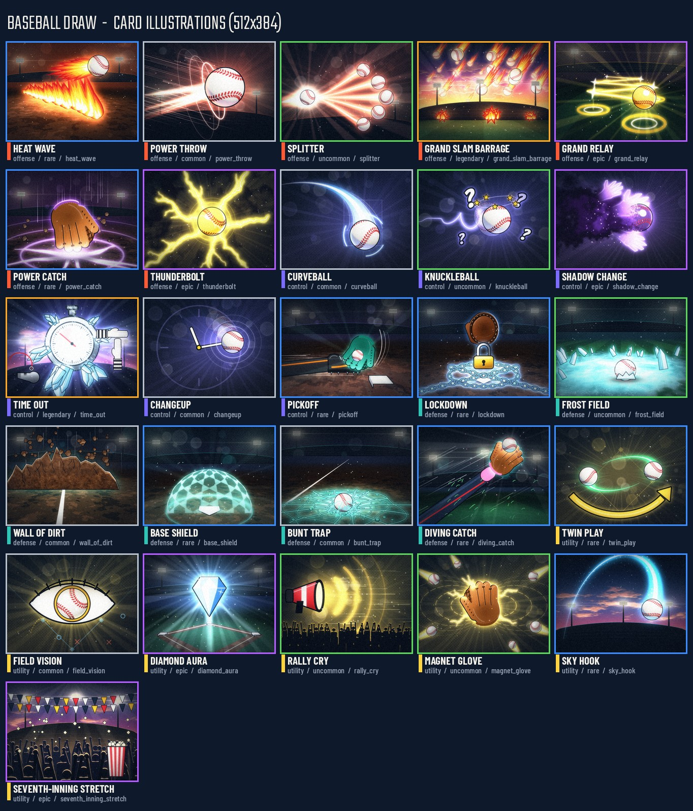
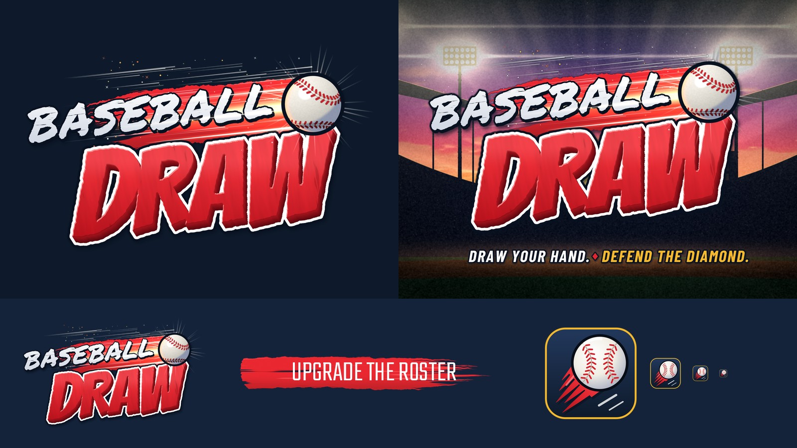
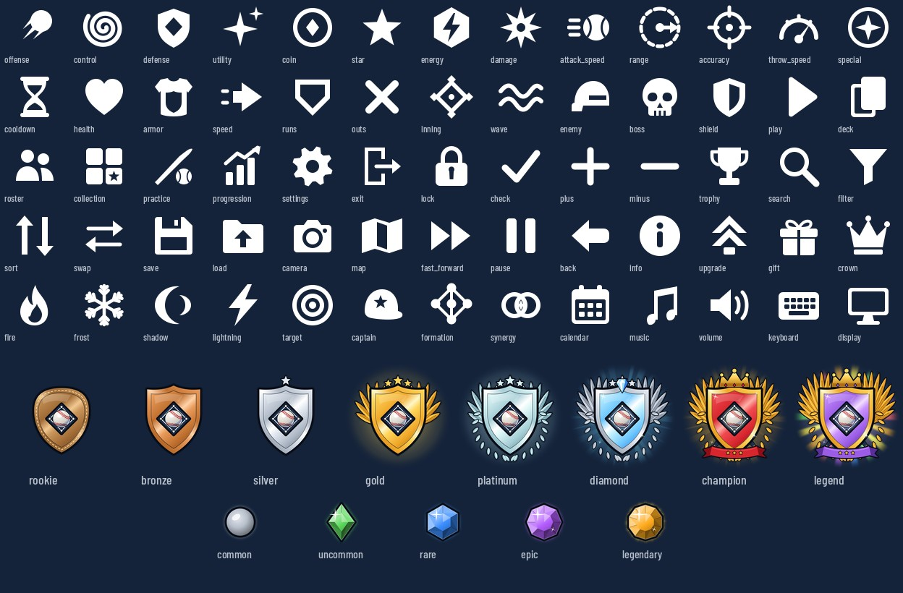
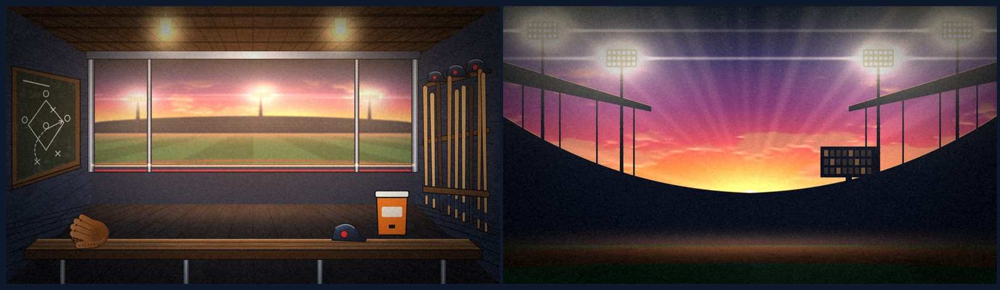

# Baseball Draw - 2D art report

All 2D art is generated procedurally by the scripts in `tools/art/` (no external images).

## Rebuild

```bash
python3 tools/art/build_art.py            # everything (~2-3 min on 4 cores)
python3 tools/art/build_art.py cards --card heat_wave   # a single card
python3 tools/art/build_art.py logo icons ranks ui appicon report
```

Requirements: Python 3.10+ with `numpy` and `Pillow`, plus the system libraries **librsvg-2** and
**cairo** (loaded with `ctypes` for SVG rasterisation and font outlines - no extra pip packages).
Fonts come from `assets/fonts/` (a temporary fontconfig file points cairo/librsvg at them; it is written
to `$ART_TMP`, default `<system temp>/baseball_draw_art`). Output is deterministic (all randomness is seeded).

| Module | Produces |
|---|---|
| `artlib/core.py` | palette, SVG rasteriser, font outlines, compositing, blur, noise |
| `artlib/fx.py` | dry-brush strokes, speed lines, halftone, lightning, vector comic flames, smoke, rays |
| `artlib/baseball.py` | 3D-shaded baseball with projected seams/stitches |
| `artlib/scene.py`, `artlib/props.py` | skies, perspective ground, stadium/crowd silhouettes; glove, stopwatch, padlock, chains... |
| `logo.py` | logo, logo_small, logo_tagline, brush_stroke |
| `cards.py` | 26 card illustrations, card_back, card_frame_glow |
| `icons.py` | 65 SVG icons |
| `ranks.py` | rank emblems, rarity gems |
| `ui_textures.py` | noise_grain, halftone, diamond_pattern, vignette, dugout_bg, loading_bg |
| `app_icon.py` | icon.svg, icon_256.png, icon.ico |
| `report.py` | this file + preview sheets |

## Previews

**Card illustrations contact sheet**  


**Logo on navy UI and on the sunset loading screen (+ small logo, brush stroke, app icon)**  


**Icons, rank emblems and rarity gems**  


**Dugout and loading backdrops**  


## Style notes

* **Palette** (ASSET_SPEC section 2): navy `#0E1A2B`/`#14233A` and charcoal `#1B1F27` are the base of every
  card and UI image; scarlet `#E0262F` (+ `#A3141C` shadow) is the brand accent (logo "DRAW", brush stroke,
  app icon); gold `#F5B82E` for currency/legendary trims; rarity and category colours are used exactly as specified.
* **Logo**: "BASEBALL" is Permanent Marker with roughened (noise-displaced) outlines, a 10 deg slant, per-letter
  jitter and dry-brush streak holes, sitting on a procedurally painted scarlet dry-brush swoosh that doubles as
  the ball's motion trail. "DRAW" is Bangers, widened 18 %, rough-edged, with an 18-step extrusion in
  scarlet_deep, bevel highlight, white outline and dark navy outer outline. The ball is a 3D-shaded render with
  projected seams/stitches, a comet glow, white light slashes, speed lines, sparks and a starburst. A global
  dark contour + drop shadow keeps it readable on the navy UI and on the bright sunset stadium.
* **Cards**: painted at 1024x768 and Lanczos-downsampled to 512x384. Shared language: dark navy backdrop,
  key light and glow in the category colour (offense `#FF5A36`, control `#7B6CFF`, defense `#2EC4B6`,
  utility `#FFD23F`; linked-defender cards also use that defender's accent), stadium light towers / bokeh for
  depth, comic ink outlines, cel-shaded props, vector comic flames, halftone corners, bloom, vignette, a shadow
  grade toward brand navy and fine grain. Rarity raises intensity: more particles, stronger bloom; epic and
  legendary add sparkle passes and the most elaborate compositions (meteor storm, frozen stopwatch). Key
  content stays inside the centre ~85 % so frames/text overlays do not cover it.
* **Icons**: 64x64 viewBox, pure white, solid silhouettes with even-odd cut-outs and 5 px round strokes,
  4 px safe margin. Only path/circle/rect/polygon + strokes are used (no filters, masks or text) so Godot's
  ThorVG importer renders them exactly; they stay legible down to 16-24 px.
* **Rank emblems**: metal shading via banded gradients and a bevelled trim; ornament escalates
  (leather stitched badge -> bronze -> silver + star -> gold + wings + stars -> platinum + laurels ->
  diamond + ice gem + rays -> champion crimson/gold + crown + crossed bats + banner -> legend purple/gold +
  crown + large wings + prismatic rays). All glows fade to zero before the canvas edge.
* **UI textures**: grain is greyscale (mean 128) for overlay/soft-light use; halftone, diamond pattern and
  grain tile seamlessly; the vignette is black with radial alpha; `card_frame_glow.png` is a white ring
  (strongest on a 256x352 rounded card outline) meant to be tinted with the rarity colour.
* **Backdrops**: the dugout keeps its centre calm (defocused sunset field seen through the opening) with
  detail on the sides (chalkboard play diagram, helmet shelf, bat rack, cooler, bench with glove/helmet);
  the loading screen keeps the upper centre clear for the logo.

## Files

### Logo (6)

- `assets/textures/logo/brush_stroke.png` 1024x160
- `assets/textures/logo/icon.ico` 16-256 multi-size
- `assets/textures/logo/icon_256.png` 256x256
- `assets/textures/logo/logo.png` 2048x1249
- `assets/textures/logo/logo_small.png` 768x469
- `assets/textures/logo/logo_tagline.png` 2048x1398

### Card illustrations (28)

- `assets/textures/cards/base_shield.png` 512x384
- `assets/textures/cards/bunt_trap.png` 512x384
- `assets/textures/cards/card_back.png` 256x352
- `assets/textures/cards/card_frame_glow.png` 300x400
- `assets/textures/cards/changeup.png` 512x384
- `assets/textures/cards/curveball.png` 512x384
- `assets/textures/cards/diamond_aura.png` 512x384
- `assets/textures/cards/diving_catch.png` 512x384
- `assets/textures/cards/field_vision.png` 512x384
- `assets/textures/cards/frost_field.png` 512x384
- `assets/textures/cards/grand_relay.png` 512x384
- `assets/textures/cards/grand_slam_barrage.png` 512x384
- `assets/textures/cards/heat_wave.png` 512x384
- `assets/textures/cards/knuckleball.png` 512x384
- `assets/textures/cards/lockdown.png` 512x384
- `assets/textures/cards/magnet_glove.png` 512x384
- `assets/textures/cards/pickoff.png` 512x384
- `assets/textures/cards/power_catch.png` 512x384
- `assets/textures/cards/power_throw.png` 512x384
- `assets/textures/cards/rally_cry.png` 512x384
- `assets/textures/cards/seventh_inning_stretch.png` 512x384
- `assets/textures/cards/shadow_change.png` 512x384
- `assets/textures/cards/sky_hook.png` 512x384
- `assets/textures/cards/splitter.png` 512x384
- `assets/textures/cards/thunderbolt.png` 512x384
- `assets/textures/cards/time_out.png` 512x384
- `assets/textures/cards/twin_play.png` 512x384
- `assets/textures/cards/wall_of_dirt.png` 512x384

### Icons (65)

- `assets/textures/icons/accuracy.svg` 64x64 viewBox
- `assets/textures/icons/armor.svg` 64x64 viewBox
- `assets/textures/icons/attack_speed.svg` 64x64 viewBox
- `assets/textures/icons/back.svg` 64x64 viewBox
- `assets/textures/icons/boss.svg` 64x64 viewBox
- `assets/textures/icons/calendar.svg` 64x64 viewBox
- `assets/textures/icons/camera.svg` 64x64 viewBox
- `assets/textures/icons/captain.svg` 64x64 viewBox
- `assets/textures/icons/check.svg` 64x64 viewBox
- `assets/textures/icons/coin.svg` 64x64 viewBox
- `assets/textures/icons/collection.svg` 64x64 viewBox
- `assets/textures/icons/control.svg` 64x64 viewBox
- `assets/textures/icons/cooldown.svg` 64x64 viewBox
- `assets/textures/icons/crown.svg` 64x64 viewBox
- `assets/textures/icons/damage.svg` 64x64 viewBox
- `assets/textures/icons/deck.svg` 64x64 viewBox
- `assets/textures/icons/defense.svg` 64x64 viewBox
- `assets/textures/icons/display.svg` 64x64 viewBox
- `assets/textures/icons/enemy.svg` 64x64 viewBox
- `assets/textures/icons/energy.svg` 64x64 viewBox
- `assets/textures/icons/exit.svg` 64x64 viewBox
- `assets/textures/icons/fast_forward.svg` 64x64 viewBox
- `assets/textures/icons/filter.svg` 64x64 viewBox
- `assets/textures/icons/fire.svg` 64x64 viewBox
- `assets/textures/icons/formation.svg` 64x64 viewBox
- `assets/textures/icons/frost.svg` 64x64 viewBox
- `assets/textures/icons/gift.svg` 64x64 viewBox
- `assets/textures/icons/health.svg` 64x64 viewBox
- `assets/textures/icons/info.svg` 64x64 viewBox
- `assets/textures/icons/inning.svg` 64x64 viewBox
- `assets/textures/icons/keyboard.svg` 64x64 viewBox
- `assets/textures/icons/lightning.svg` 64x64 viewBox
- `assets/textures/icons/load.svg` 64x64 viewBox
- `assets/textures/icons/lock.svg` 64x64 viewBox
- `assets/textures/icons/map.svg` 64x64 viewBox
- `assets/textures/icons/minus.svg` 64x64 viewBox
- `assets/textures/icons/music.svg` 64x64 viewBox
- `assets/textures/icons/offense.svg` 64x64 viewBox
- `assets/textures/icons/outs.svg` 64x64 viewBox
- `assets/textures/icons/pause.svg` 64x64 viewBox
- `assets/textures/icons/play.svg` 64x64 viewBox
- `assets/textures/icons/plus.svg` 64x64 viewBox
- `assets/textures/icons/practice.svg` 64x64 viewBox
- `assets/textures/icons/progression.svg` 64x64 viewBox
- `assets/textures/icons/range.svg` 64x64 viewBox
- `assets/textures/icons/roster.svg` 64x64 viewBox
- `assets/textures/icons/runs.svg` 64x64 viewBox
- `assets/textures/icons/save.svg` 64x64 viewBox
- `assets/textures/icons/search.svg` 64x64 viewBox
- `assets/textures/icons/settings.svg` 64x64 viewBox
- `assets/textures/icons/shadow.svg` 64x64 viewBox
- `assets/textures/icons/shield.svg` 64x64 viewBox
- `assets/textures/icons/sort.svg` 64x64 viewBox
- `assets/textures/icons/special.svg` 64x64 viewBox
- `assets/textures/icons/speed.svg` 64x64 viewBox
- `assets/textures/icons/star.svg` 64x64 viewBox
- `assets/textures/icons/swap.svg` 64x64 viewBox
- `assets/textures/icons/synergy.svg` 64x64 viewBox
- `assets/textures/icons/target.svg` 64x64 viewBox
- `assets/textures/icons/throw_speed.svg` 64x64 viewBox
- `assets/textures/icons/trophy.svg` 64x64 viewBox
- `assets/textures/icons/upgrade.svg` 64x64 viewBox
- `assets/textures/icons/utility.svg` 64x64 viewBox
- `assets/textures/icons/volume.svg` 64x64 viewBox
- `assets/textures/icons/wave.svg` 64x64 viewBox

### UI (ranks, gems, textures, backdrops) (19)

- `assets/textures/ui/diamond_pattern.png` 512x512
- `assets/textures/ui/dugout_bg.png` 1920x1080
- `assets/textures/ui/gem_common.png` 64x64
- `assets/textures/ui/gem_epic.png` 64x64
- `assets/textures/ui/gem_legendary.png` 64x64
- `assets/textures/ui/gem_rare.png` 64x64
- `assets/textures/ui/gem_uncommon.png` 64x64
- `assets/textures/ui/halftone.png` 256x256
- `assets/textures/ui/loading_bg.png` 1920x1080
- `assets/textures/ui/noise_grain.png` 256x256
- `assets/textures/ui/rank_bronze.png` 256x256
- `assets/textures/ui/rank_champion.png` 256x256
- `assets/textures/ui/rank_diamond.png` 256x256
- `assets/textures/ui/rank_gold.png` 256x256
- `assets/textures/ui/rank_legend.png` 256x256
- `assets/textures/ui/rank_platinum.png` 256x256
- `assets/textures/ui/rank_rookie.png` 256x256
- `assets/textures/ui/rank_silver.png` 256x256
- `assets/textures/ui/vignette.png` 1024x1024

### App icon (1)

- `icon.svg` 256x256 viewBox

## Limitations

- Illustrations are stylised vector/procedural paintings (no figure drawing): characters appear as
  silhouettes, hands, gloves and props rather than full posed players.
- `noise_grain.png` is an 8-bit greyscale texture; use it with an overlay/soft-light blend or as an alpha source.
