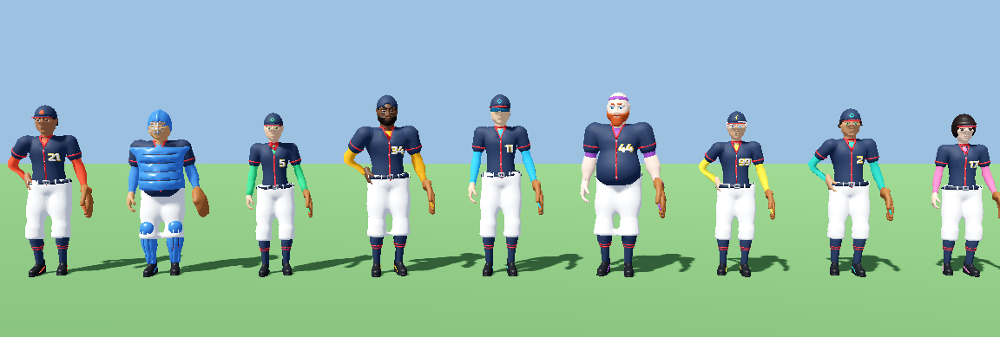
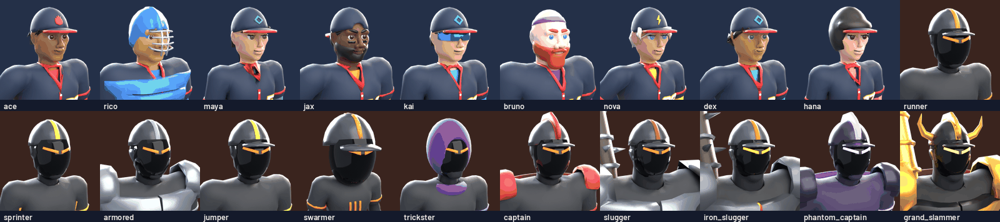
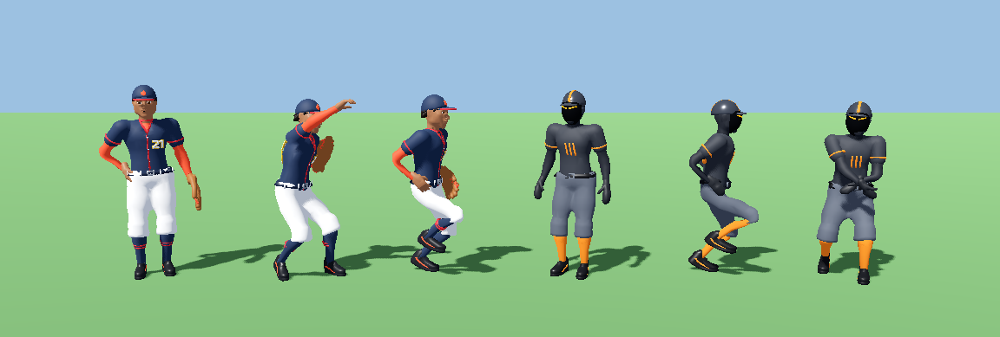
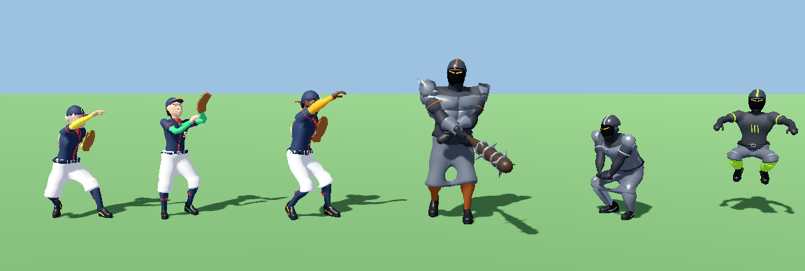
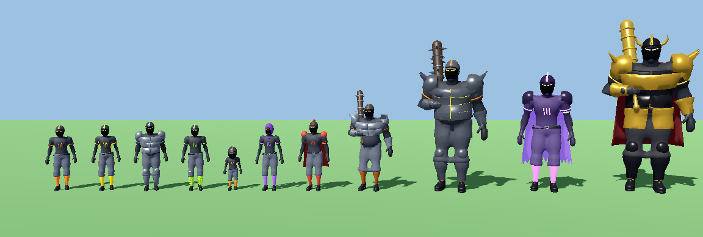
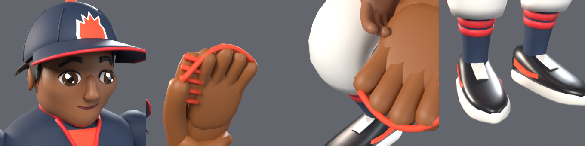

# Characters — build report

**Status: COMPLETE — all 20 GLBs + 20 portraits are final builds.** The 9 defenders were later **redesigned as
stylised heroes and rebuilt with a new mesh-modelling path** (section 0); enemies/bosses are unchanged. Every GLB was imported into a scratch Godot 4.7.2 project and
inspected, and re-imported into Blender to measure foot sliding / ground contact / loop seams.

## 0. Defenders: stylised hero rebuild

The first defender pass (SDF sculpts polygonised with surface nets, then decimated) read as small, lumpy, near-identical
figures from the game camera. All nine were rebuilt with a new generator path (`hero.py`, `hero_head.py`,
`hero_body.py`, `hero_wear.py`, `geo.py`, `hutil.py`); the GLB contract (nodes, 22 bones, clip names/lengths/events,
material names, origin, heights) is unchanged.

* **Proportions**: head ≈ 1/5.3–1/5.6 of the height (chin→crown 0.32–0.36 m), short neck, broad shoulders, tapered
  waist, legs ≈ 47–51 % of the height, chunky hands (`hand_scale` 1.2–1.5) and cleats. Body types kept: Bruno huge
  with a belly, Rico stocky/short-legged, Jax broad V, Kai long-legged, Maya/Nova/Hana slim.
* **Modelling** (no SDF polygonisation, no decimation): limbs, torso, socks, sleeves and cleats are parametric lofts
  (cubic-spline profiles, crisp folded hems); the pants are a mirrored box cage (crotch topology) + Catmull-Clark
  with creased hems; head, hair, cap crown, visor, helmet and beards are clean sphere grids projected onto smooth
  implicit shapes; numbers, emblems, eyes, brows, mouth, laces, swooshes, buckle and V-insert are thin decals
  projected onto the surface under them (they copy its skin weights, so they never float).
* **Faces**: big eye whites with iris, pupil and two emissive highlights (`EyeHighlight`), dark upper lid line (+ lash
  flick for the women), shaped brows, simple nose, expressive mouths (smirk / smile / open smile / grin with teeth).
* **Uniform**: jersey with collar + V piping, accent V-insert, placket piping, sleeve-hem piping, front + back numbers
  with gold outline, belt with buckle and loops, pant side stripes, socks with two stripes, cleats with white sole,
  laces and an accent swoosh; caps with 4 panel seams, accent button, accent emblem with white outline, brim piping.
* **Identities (silhouette + accent)**: Ace spiky tufts + flame cap; Rico blue catcher helmet/face cage, chest
  protector, shin guards, round mitt; Maya swinging ponytail with green tie, bare forearms + green wristbands; Jax
  backwards cap, framing beard, eye black; Kai cyan wraparound shades; Bruno bald with purple headband, big red beard,
  bare forearms; Nova platinum pixie with side-swept fringe, bolt cap; Dex curls around the cap; Hana black bob with
  bangs + pink-striped sun visor.
* **Sock / pant layering**: the sock top is tucked 7.5 cm (4.5 cm under Rico's knee pants) under the cuff, not
  up at the knee, and under the cuff its radius stays 12 % inside the pant's inner fold (calf bulge only below the
  hem). The sock and the pant leg below the knee share *axial* weights (a function of the position along the shin
  only, `hero.axial_weights`), so a sock point and the pant point radially outside it always get the same bone
  matrix and the sock cannot poke through the cuff in any clip (it used to, by 4–7 cm at the back of the cuff /
  knee crease in run, ready, throw, pitch, catch). The sock inside the cleat follows the foot like the cleat.
* **Uniform layering (Update 5)**: layered clothing shares skin weights (`hero.share_weights`): the undershirt
  arm under the jersey sleeve, the waistband over the tucked jersey, the forearm skin under an elbow cuff and
  the neck base inside the collar take the outer garment's weights and blend back to their own past its edge.
  The tucked jersey is pulled 1.4 cm inside the pants below the waistband and ends 7 cm under it. Measured
  with `check_layers.py` (worst poke-through over the gameplay clips: sleeves 2–6.4 cm → ≤ 1.3 cm in the blend
  band below the hem, waist up to 3.1 cm → 0). Review strips: `review_frames.py`. Findings in
  `docs/plans/review/characters.md`.
* **Budget** raised to 20 000 triangles; every defender is built under it without decimation. Build time ≈ 10 s per
  defender + portrait.
* **Animation**: same clips/lengths/events. Because the legs are shorter relative to the global scale, defender hip
  offsets and stride lengths now scale with the leg length (`anim.Ctx.lk`, 1.0 for enemies, so enemy clips are
  unchanged); the pitch kick dips the hips a little more so the pivot leg stays planted.



Current stylised defenders in Godot through the game's `CharacterModel` (merged vertex-colour shader, home uniform),
`idle` pose.

## 1. Rebuild

```
# everything (20 GLBs + 20 portraits), ~2-3 min per character on 4 cores
/opt/tools/bpyenv/bin/python tools/blender/characters/build_characters.py
# selected ids / flags
/opt/tools/bpyenv/bin/python tools/blender/characters/build_characters.py ace runner [--no-portraits] [--no-glb]
# metrics of the exported GLBs (foot slide, lowest mesh point, loop seams) -> characters_verify.json
/opt/tools/bpyenv/bin/python tools/blender/characters/verify_characters.py [ids...]
```

Outputs `assets/models/characters/<id>.glb`, `assets/textures/portraits/<id>.png`, and machine-readable summaries
`docs/asset_reports/characters_build.json` / `characters_verify.json`. Fully procedural and deterministic: defenders
are mesh-modelled (section 0); enemy/boss bodies, heads, clothes and gear are numpy SDF sculpts polygonised with
surface nets and decimated in Blender to the budgets;
weights are computed procedurally; animations are authored with a custom FK/two-bone-IK pose solver and baked.
Jersey numbers use the repo font `assets/fonts/RussoOne-Regular.ttf`. Materials are flat colours only (no textures,
no UVs needed).

Source `tools/blender/characters/`: `build_characters.py` (entry, assembly, export), `roster.py` (all character
definitions), `rig.py` (shared armature + pose solver), `anim.py` (all clips), `skin.py` (weights), `body.py`,
`heads.py`, `outfit.py`, `enemies.py` (enemy modelling), `hero.py` + `hero_head.py`, `hero_body.py`,
`hero_wear.py`, `hutil.py`, `geo.py` (defender modelling), `sdf.py` (SDF + polygoniser), `meshutil.py`,
`materials.py`, `render.py`, `portrait.py`, `verify_characters.py`.

## 2. GLB contents (verified in Godot 4.7.2, identical for all 20)

```
<id> (Node3D)
├─ Armature (Node3D)
│  └─ Skeleton3D                 path: Armature/Skeleton3D   (22 bones)
│     └─ Body (MeshInstance3D)   path: Armature/Skeleton3D/Body  (single skinned mesh, one surface per material)
└─ AnimationPlayer               path: AnimationPlayer
```

* Bones (names/hierarchy exactly ASSET_SPEC 3.1): `root, hips, spine, chest, neck, head, shoulder.L, upper_arm.L,
  forearm.L, hand.L, shoulder.R, upper_arm.R, forearm.R, hand.R, thigh.L, shin.L, foot.L, toe.L, thigh.R, shin.R,
  foot.R, toe.R`. Body types only change bone lengths/thickness.
* Origin on the ground between the feet, front = +Z in Godot (−Y in Blender), metres, real in-game size for
  enemies/bosses (no scaling needed).
* Tracks: `Armature/Skeleton3D:<bone>` rotations for all bones + `hips` position. Godot's importer drops tracks
  that never change (e.g. `root`, clavicles) — expected.
* Rigid parts use 100 % weight on one bone: cap/helmet/hair/eyes/glasses/horns → `head`, mitt → `hand.L`,
  bats → `hand.R`, defender right hand → `hand.R` (the game spawns the ball there), Rico's shin guards → `shin.*`.
* Materials (exact spec names): defenders `Skin, Hair, Eyes, Iris, Pupil, Jersey, JerseyTrim, Number,
  NumberOutline, Pants, Socks, Shoes, Belt, Cap, Glove, Undershirt, Metal, Mouth, Sole, EyeHighlight` (+ `Gear` for
  Rico, `Visor` for Kai, `Brow` for Nova). `Undershirt` = accent colour (undershirt sleeves, V-neck insert, cap button
  + emblem, glove lacing + patch, shoe swoosh, Maya's hair tie/wristbands, Bruno's headband, Hana's visor stripe).
  Hana's sun visor uses `Cap`. Every small detail (eye highlights, piping, numbers, laces) is separate geometry with
  its own material, so it survives the game's merge into one vertex-coloured mesh.
  Enemies/bosses `Jersey` (gunmetal), `JerseyTrim` (type accent), `Pants, Socks, Shoes, Belt, Glove`,
  `Undershirt` (charcoal long sleeves + head under the helmet), `Gear` (helmet/dark armour), `Metal`
  (steel/iron/gold plates, buckle), `Glow` (emissive eye slit, molten seams, phantom trims), `Bat`, `Cloth` (capes,
  hood, scarf), `Number` (back number). Extra names: `Pupil`, `NumberOutline`, `Visor` (see deviations).

## 3. Animations (names + lengths as imported in Godot; event times as built)

| clip | length (s) | loop | event (s) | as built |
|---|---|---|---|---|
| `idle` | 2.0 | yes | | breathing + weight shift, feet IK-locked; Ace/Jax/Dex/Nova rest the right fist on the hip; enemies hunch, bat holders rest the bat on the shoulder |
| `run` | 0.70 | yes | | contact/passing poses, opposite arm/leg, hip bob, counter-rotating shoulders, heel-off toe roll |
| `hit` | 0.35 | no | | flinch back, returns to an idle-like pose |
| `stunned` | 1.2 | yes | | dazed wobble, right hand on the head, feet locked |
| `defeat` | 1.2 | no | | stagger, fall backwards, ends lying on the back (`hips` moves back ≈0.55×scale m and down) |
| `celebrate` | 1.0 | yes | | hop + right fist pump (feet leave the ground mid-hop) |
| `ready` (def.) | 1.6 | yes | | athletic crouch, glove low in front with the pocket open, double bounce |
| `throw` (def.) | 0.75 | no | **release 0.30** | gather → cock (hand behind head, glove arm at target) → release with hand.R high and in front of the head, shoulders open → follow-through across the body → ready pose |
| `pitch` (def.) | 1.40 | no | **release 0.85** | set, 80° turn, leg kick ≈0.50, stride lands 0.72, arm cocks, release 0.85, follow-through with back-leg swing, recovers to a fielding crouch at the origin |
| `catch` (def.) | 0.60 | no | **catch 0.25** | glove up/forward with the pocket toward the ball at 0.25, give, glove to chest, back to ready |
| `special` (def.) | 1.20 | no | **impact 0.70** | coiled power-up crouch 0–0.45, explosive stride-throw, release at 0.70 |
| `victory` (def.) | 2.0 | yes | | glove raised, right fist pumps, knee bounce |
| `walk` | 1.0 | yes | | relaxed heel-toe walk; slugger + bosses: heavy wide rolling stomp with hip drop on each foot strike |
| `sprint` (enemy) | 0.55 | yes | | aggressive forward lean, long stride, hard arm pump |
| `leap` (enemy) | 0.80 | no | **land 0.80** | crouch 0–0.15, push-off, tucked legs in the air (hips stay at standing height — the game moves the node), landing pose on the last frame |
| `swing` (enemy) | 1.0 | no | **impact 0.50** | two-handed swing: stride, hips then shoulders rotate, bat barrel in front of the body at 0.50, follow-through (non-bat enemies swing their fists) |
| `slam` (enemy) | 1.4 | no | **impact 0.90** | both hands/bat overhead, down to the ground in front at 0.90 in a deep squat, recover |
| `taunt` (enemy) | 1.5 | no | | chest out, arms wide with laughing shoulder shakes, then points at the defenders (bat raised for bat holders) |

Defenders (13): idle, run, hit, stunned, defeat, celebrate, ready, throw, pitch, catch, special, victory, walk.
Enemies + bosses (12): idle, run, hit, stunned, defeat, celebrate, sprint, leap, swing, slam, taunt, **walk** (added on
request).

* **Loop flags are not stored in glTF** — set `Animation.LOOP_LINEAR` for idle, run, stunned, celebrate, ready,
  victory, walk, sprint (first and last keys are identical; measured seam 0.0).
* In place: `root` never moves; body motion is on `hips` (bob, weight shift, the `defeat` fall, the stride in
  `pitch`/`throw`); all non-looping clips except `defeat` return near the start pose.
* **Natural ground speed** = speed at which the stance foot does not slide with `speed_scale = 1`; for another move
  speed use `speed_scale = move_speed / natural_speed` (e.g. a boss walking at 1.2 m/s).

## 4. Per-character numbers (triangles after triangulation, height = top of mesh in rest pose)

| id | kind | height (m) | triangles (budget) | clips | natural speed walk / run / sprint (m/s) |
|---|---|---|---|---|---|
| ace | defender | 1.81 | 19096 (20000) | 13 | 0.77 / 2.50 |
| rico | defender | 1.76 | 19638 (20000) | 13 | 0.71 / 2.30 |
| maya | defender | 1.73 | 19942 (20000) | 13 | 0.73 / 2.39 |
| jax | defender | 1.92 | 19606 (20000) | 13 | 0.82 / 2.65 |
| kai | defender | 1.93 | 19276 (20000) | 13 | 0.86 / 2.78 |
| bruno | defender | 1.95 | 17896 (20000) | 13 | 0.84 / 2.74 |
| nova | defender | 1.75 | 19790 (20000) | 13 | 0.74 / 2.41 |
| dex | defender | 1.78 | 19758 (20000) | 13 | 0.76 / 2.45 |
| hana | defender | 1.71 | 19334 (20000) | 13 | 0.72 / 2.35 |
| runner | enemy | 1.76 | 8714 (9000) | 12 | 0.78 / 2.54 / 4.08 |
| sprinter | enemy | 1.78 | 8713 (9000) | 12 | 0.77 / 2.51 / 4.03 |
| armored | enemy | 1.86 | 8707 (9000) | 12 | 0.83 / 2.68 / 4.31 |
| jumper | enemy | 1.79 | 8712 (9000) | 12 | 0.77 / 2.51 / 4.03 |
| swarmer | enemy | 1.19 | 8838 (9000) | 12 | 0.52 / 1.68 / 2.70 |
| trickster | enemy | 1.82 | 8707 (9000) | 12 | 0.80 / 2.61 / 4.19 |
| captain | enemy | 1.92 | 8709 (9000) | 12 | 0.83 / 2.71 / 4.35 |
| slugger | enemy | 2.36 | 8709 (9000) | 12 | 1.19 / 3.45 / 5.54 |
| iron_slugger | boss | 3.54 | 21315 (22000) | 12 | 1.78 / 5.17 / 8.30 |
| phantom_captain | boss | 3.21 | 16961 (22000) | 12 | 1.51 / 4.52 / 7.26 |
| grand_slammer | boss | 4.21 | 21312 (22000) | 12 | 2.08 / 6.03 / 9.69 |

| id | look |
|---|---|
| ace | stylised athletic pitcher, medium-brown skin, spiky dark tufts under the cap, confident smirk, red-orange accent, flame cap emblem, #21 |
| rico | stocky catcher, tan skin, steel-blue hockey-style catcher helmet with steel face cage + black trim, segmented chest protector, knee caps + shin guards (`Gear`), round catcher's mitt, big grin, #8 (back only) |
| maya | slim infielder, light-medium skin, big swinging ponytail out of the cap's back opening (green tie), side locks, bare forearms + green wristbands, open smile, #5 |
| jax | tall broad infielder, dark skin, cap backwards (snapback opening at the forehead), framing beard + mustache, eye black, orange-gold accent, #34 |
| kai | lean long-legged outfielder, cyan wraparound shades with black frame, short hair tufts, #11 |
| bruno | huge heavy-set outfielder, bald, purple headband with knot tails, big red beard, grin, purple elbow sleeves + bare forearms, #44 |
| nova | female pitcher, platinum pixie with side-swept fringe and nape tufts, darker brows, yellow accent, lightning-bolt emblem, #99 |
| dex | slim infielder, curls bursting from under the cap, sly smirk, teal accent, #2 |
| hana | female outfielder, black bob with pointed bangs + flipped ends, navy sun visor with pink stripe, big smile, #17 |
| runner | Wrecker base: gunmetal uniform, hazard-orange trim/socks, batting helmet + ear flap, dark visor, glowing V slit, claw chest emblem, #13 |
| sprinter | slim, aerodynamic tail helmet, yellow lightning bolts on torso sides and thighs, #7 |
| armored | bulky, steel chest/back plate, layered pauldrons, greaves + knee caps, two-flap riot helmet, #66 |
| jumper | lime coil-spring shin guards, knee braces, long legs, #3 |
| swarmer | 1.19 m, oversized helmet, big hands/feet, #0 |
| trickster | lean, purple hood + mask with glowing eyes, purple scarf with tails, #9 |
| captain | broad, crested helmet, crimson cape, red pauldrons, gold armband, #1 |
| slugger | 2.36 m brute, spiked iron pauldrons, chest plate, gauntlets, giant iron-banded spiked bat in `hand.R` |
| iron_slugger | 3.54 m boss, full iron plates with glowing molten seams, spiked pauldrons, gauntlets, tassets, greaves, giant spiked bat |
| phantom_captain | 3.21 m boss, ghostly violet, semi-transparent tattered cape (`Cloth`, alpha 0.72), glowing violet eyes/trims |
| grand_slammer | 4.21 m final boss, black-and-gold armour, golden horns + crest, dark-red cape, giant golden bat |

## 5. Portraits

512×512 RGBA, transparent, Cycles CPU (96 samples + OpenImageDenoise), head-and-shoulders 3/4 view of the `idle` pose,
identical key/fill/2-rim/top rig scaled by head size. Defenders: tight crop (1.6 head heights), slightly low camera,
warm key + cool fill + soft bounce; enemies use a more frontal crop so helmet colours and the glowing eyes read at
icon size.



## 6. Verification

1. Godot 4.7.2 import of all 20 GLBs: no errors; every file has `Armature/Skeleton3D` (22 bones),
   `Armature/Skeleton3D/Body`, `AnimationPlayer` with the clips/lengths above (lengths exact: hit 0.350, throw 0.750…).
2. GLB re-import metrics (`verify_characters.py`, 60 Hz, every 2nd frame):

| id | max foot slide in planted clips (m) | lowest mesh point over all clips (m) | worst loop seam (m) |
|---|---|---|---|
| ace | 0.0000 | -0.017 (defeat: -0.012) | 0.0000 |
| rico | 0.0000 | -0.022 (defeat: -0.016) | 0.0000 |
| maya | 0.0000 | -0.017 (defeat: -0.026) | 0.0000 |
| jax | 0.0000 | -0.018 (defeat: -0.014) | 0.0000 |
| kai | 0.0000 | -0.021 (defeat: -0.012) | 0.0000 |
| bruno | 0.0000 | -0.019 (defeat: -0.021) | 0.0000 |
| nova | 0.0000 | -0.017 (defeat: -0.011) | 0.0000 |
| dex | 0.0000 | -0.017 (defeat: -0.012) | 0.0000 |
| hana | 0.0000 | -0.016 (defeat: -0.011) | 0.0000 |
| runner | 0.0000 | -0.022 (defeat: -0.032) | 0.0000 |
| sprinter | 0.0000 | -0.019 (defeat: -0.032) | 0.0000 |
| armored | 0.0000 | -0.024 (defeat: -0.034) | 0.0000 |
| jumper | 0.0000 | -0.019 (defeat: -0.032) | 0.0000 |
| swarmer | 0.0000 | -0.021 (defeat: -0.028) | 0.0000 |
| trickster | 0.0000 | -0.021 (defeat: -0.070) | 0.0000 |
| captain | 0.0000 | -0.023 (defeat: -0.160) | 0.0000 |
| slugger | 0.0000 | -0.039 (defeat: -0.041) | 0.0000 |
| iron_slugger | 0.0000 | -0.045 (defeat: -0.066) | 0.0000 |
| phantom_captain | 0.0000 | -0.040 (defeat: -0.378) | 0.0000 |
| grand_slammer | 0.0000 | -0.052 (defeat: -0.424) | 0.0000 |

   Foot slide is measured on grounded feet in idle/ready/stunned/hit/victory/taunt/slam/catch (IK-locked → 0).
   Rebuilt defenders: cleats are weighted to `foot`/`toe` only, the heel raise is clamped at ≥ 0 and the toes stay flat
   while the heel leaves the ground in `defeat`, so their lowest points stay within the first pass's range (walk
   toe-off ≈ 1.6–2.2 cm) and `defeat` now rests on the back at ≈ 1–2.6 cm (was ≈ 3.3 cm).
   The lowest non-`defeat` points are single frames of shoe tips at the `leap` landing / `pitch` pivot (≈1–2 % of
   height). In `defeat` the cape wearers' capes sink into the ground while lying on the back.
3. In-engine (Godot Forward+, directional light):



ace idle / throw at 0.30 (release) / run mid-stride; runner idle / run / swing at 0.50. (This image and the next one
show the first-pass defender models; the current defenders are in the lineup below and in section 0.)



nova pitch at 0.85 (release), maya catch at 0.25, jax special at 0.70, slugger swing at 0.50, armored slam at 0.90,
jumper leap at 0.45 (node not moved, so it hangs in the air).


Current stylised defenders in Godot through the game's `CharacterModel` (merged vertex-colour shader, home uniform),
`idle` pose.



4. Blender close-ups of the rebuilt ace (Cycles): face/cap in `idle`, glove pocket + laced web at the `catch` event
   (0.25 s), right hand over the glove in `ready`, cleats (white sole, laces, accent swoosh).



## 7. Deviations from ASSET_SPEC

* **Baked at 60 Hz instead of 30 fps**: 0.35 s (`hit`) and 0.75 s (`throw`) are not whole frames at 30 fps
  (they imported as 0.333 / 0.733 s). At 60 Hz all lengths and event times are exact. Times in seconds unchanged.
* **Extra material names**: `Mouth` (mouth interior/line), `Sole` (cleat soles + laces), `EyeHighlight` (emissive
  eye sparkles), `Brow` (Nova's darker brows), and from the first pass `Pupil` (black pupils, lid lines, eye black,
  Kai's glasses frame),
  `NumberOutline` (gold number outline asked for by the palette section), `Visor` (glossy dark enemy visors, Kai's
  cyan lenses). No spec name was renamed or repurposed.
* `walk` added to enemies/bosses (lead request).
* Defenders (redesign, lead request): head ≈ 1/5.3–1/5.6 of the height instead of ASSET_SPEC's ≈ 1/6.5, and a
  20 000-triangle budget (was 14 000). Heights stay within 1 % of the first pass (Hana 1.709 vs 1.722 m, Rico 1.756
  vs 1.768 m), so the game's AABB-based scaling is unchanged.
* Heights within 2 % of targets (runner 1.76, slugger 2.36, iron_slugger 3.54, phantom 3.21, grand_slammer 4.21,
  swarmer 1.19 m).
* `Metal` metallic 0.55–0.7 (not 1.0) so plates stay readable without a sky/reflection probe.

## 8. Known limitations

* No finger/face bones (per spec): hands are fixed modelled poses (relaxed right hand, fists for enemies); no blinking.
* Defender parts are separate overlapping shells (sleeve over arm, cap over hair, decals over cloth); at extreme arm
  raises the sleeve's shoulder cap and the jersey's shoulder line meet with a visible crease.
* Linear-blend skinning, no corrective shapes: some stretch at the crotch/inner thigh in wide stances and at the
  shoulder with the arm fully raised.
* Capes, hood, scarf, ponytail are skinned to spine/neck/hips (no secondary motion): capes can touch the thighs in long
  strides and sink into the ground in `defeat`.
* Shoe tips dip ≤ 2 cm (≤ 5 cm on 3.5–4.2 m bosses) below ground in single frames (leap landing, pitch pivot);
  bodies ≤ 3–4 cm into the ground at the end of `defeat`.
* Arms are IK-clamped (fully extended) in a few frames where the target is out of reach (throw/pitch follow-through,
  slam on big bodies).
* Phantom's `Cloth` is alpha-blended (sorting may need care in Godot; it also matters if the game merges surfaces).
* Enemy/boss hair and thin shells are decimated SDF meshes (defenders no longer use that path).
* Hair, ponytail and beards are rigid to `head` (no secondary motion).
* Loop mode must be set by the game (glTF has no loop flag).
