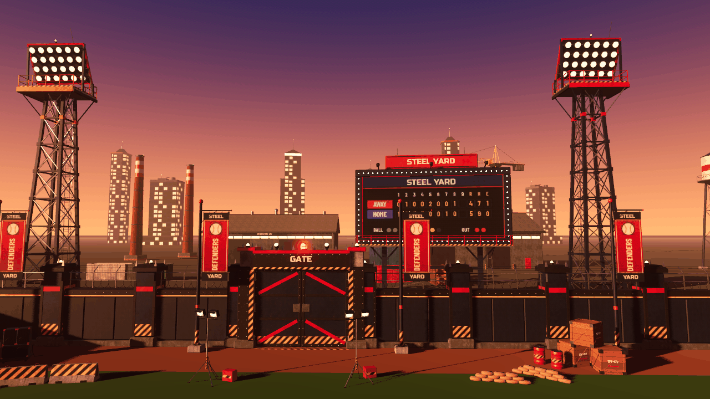
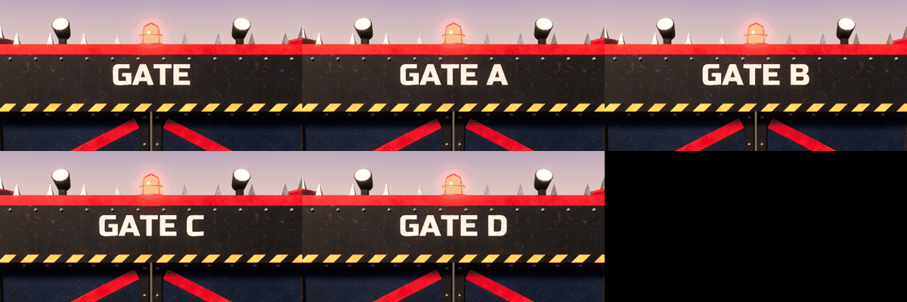
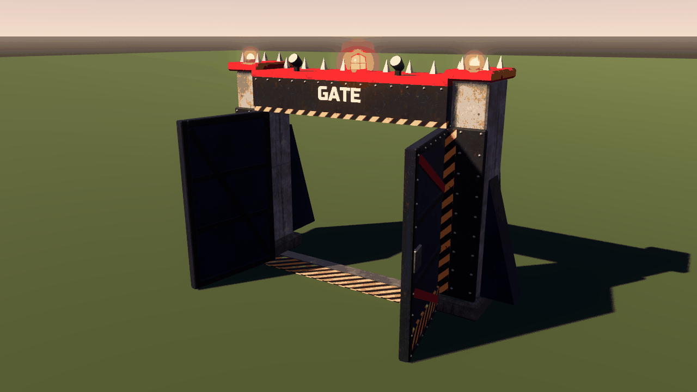
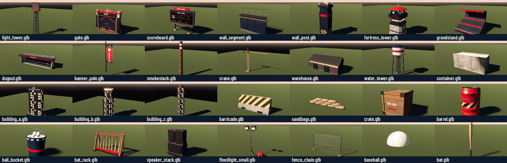
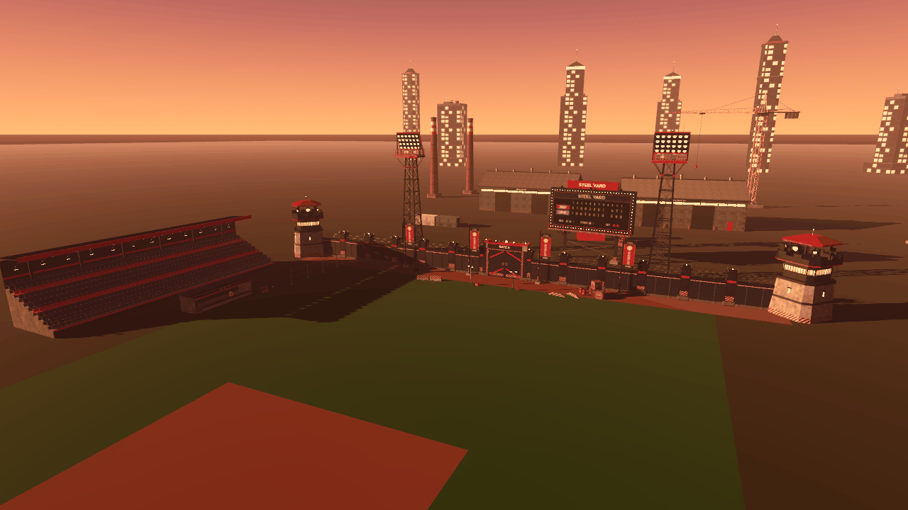
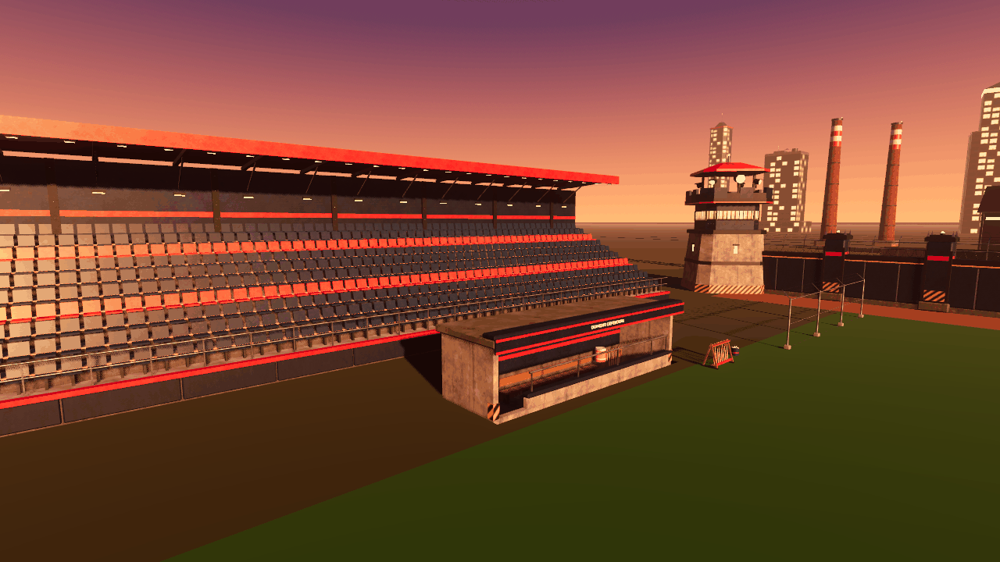

# Props report — "The Steel Yard" stadium & industrial set



All 32 props are generated procedurally by Blender 5.2.3 (bpy) scripts. Their textures come from numpy, plus Pillow for the two text placeholders. Every prop was imported and checked in a separate Godot 4.7.2 project. All screenshots on this page are in-engine Godot renders (Forward+, Vulkan on lavapipe, sunset sky, ACES, glow).

## 1. Rebuild

```sh
# from the repo root: all props (about 20 s, deterministic: a rebuild gives byte-identical files)
/opt/tools/bpyenv/bin/python tools/blender/props/build_props.py
# some props / options
/opt/tools/bpyenv/bin/python tools/blender/props/build_props.py gate wall_segment
/opt/tools/bpyenv/bin/python tools/blender/props/build_props.py --list
/opt/tools/bpyenv/bin/python tools/blender/props/build_props.py --embed      # self-contained GLBs (textures packed)
/opt/tools/bpyenv/bin/python tools/blender/props/build_props.py --out DIR --stats stats.json --blend DIR
# verify in a throw-away Godot project (never touches the main project); add --shots for screenshots
tools/blender/props/godot_check/run_check.sh [workdir] [--shots]
```

Requirements:
* `/opt/tools/bpyenv` (bpy 5.2.3 + numpy).
* The system `python3` with Pillow. It runs `text_textures.py` for the scoreboard and banner placeholders; without Pillow those two textures fall back to flat colours.
* The fonts `assets/fonts/RussoOne-Regular.ttf` and `BarlowCondensed-Bold.ttf`.

| file (`tools/blender/props/`) | role |
|---|---|
| `build_props.py` | CLI driver: registry, scene reset, glTF export, stats, shared-texture post-process |
| `pmesh.py` | mesh builder (boxes, chamfered boxes/hulls, prisms, cylinders, lathes, tubes, text, UV grids, auto box-UVs) |
| `pmat.py` | shared PBR material library (names, metallic/roughness/emission, texture hookup) |
| `ptex.py` | tileable procedural textures (FFT noise): painted steel, concrete, hazard, brick, corrugated + normal, wood, windows, chain link, baseball seam… |
| `text_textures.py` | Pillow: `screen.png` (1152×512 LED scoreboard placeholder), `banner.png` (512×1344) |
| `glb_tools.py` | moves GLB images into the shared `textures/` folder and writes the Godot `.import` presets |
| `props_hero.py`, `props_industry.py`, `props_small.py` | the prop builders |
| `godot_check/` (has `.gdignore`) | `verify.gd`, `inspect.gd`, `shot.gd`, `run_check.sh`, project template |

### Output layout: shared textures

`assets/models/props/<name>.glb` plus `assets/models/props/textures/` (38 textures, about 1 MB, each with a Godot `.import` preset).

The props share one material and texture library, so the GLBs reference `textures/<file>` through relative image URIs instead of each embedding copies. Without this, Godot would extract around 180 duplicate images next to the GLBs and load duplicate copies into VRAM.

The `.import` presets set mipmaps on, VRAM compression, and the normal-map flag for the `*_n.jpg` files. They are needed because a headless or game-only import never runs the editor's "detect 3D" pass, and without them the textures import with no mipmaps (I saw visible aliasing). Godot adds `uid=` lines to these files on first import, which is expected. Keep `textures/` next to the GLBs. Use `--embed` if you ever need standalone files.

## 2. Conventions

* Units are metres. In Godot: Y up, and the **front faces +Z** (in Blender the front faces −Y; exported with `export_yup`).
* Origin is at ground level at the footprint centre. Exceptions: `baseball` (ball centre, for spinning projectiles), `bat` (knob end, bat along +Y), and `dugout` (the pit floor sits below ground, see §6).
* Each GLB imports as a `Node3D` named after the file. **All nodes are direct children of that root**, so the node paths below are relative to the instanced scene. Normal mesh nodes are named after the prop in PascalCase (`LightTower`, `WallSegment`, …).
* Modifiers are applied, and the exports contain no cameras, lights or animations. Normals come from the topology: chunky parts are faceted, round parts are smooth. Backface culling is on except for `Banner` and `ChainLink`.

## 3. Material library (shared names across all GLBs)

| material | look | metal / rough | notes |
|---|---|---|---|
| `SteelNavy`, `SteelCharcoal`, `SteelScarlet` | painted steel (#1C2E4A / #262A31 / #C41F29) with mottling, grime, rust streaks, scratches | 0.35/0.48, 0.4/0.52, 0.3/0.42 | main structure / accents |
| `SteelGalv`, `SteelDark` | bare galvanised / dark oxidised steel | 0.85/0.36, 0.75/0.5 | lattices, rails, wire, hardware |
| `Concrete`, `ConcreteDark` | weathered concrete (formwork joints, tie holes, water stains) | 0/0.92 | |
| `Hazard` | worn yellow/black diagonal stripes | 0.15/0.55 | |
| `Padding` | dark navy padded vinyl | 0/0.62 | outfield wall, podium, dugout rail |
| `SafetyYellow`, `PaintWhite`, `Rust`, `Rubber`, `Glass` | | | `SafetyYellow` = home-run line, step nosings, crane |
| `Brick`, `Corrugated`(+normal), `RoofSheet`(+normal), `Wood`, `Sandbag` | | | |
| `Container` (+normal) | **light neutral grey** corrugated skin, meant to be tinted (albedo_color multiplies it) | 0.1/0.55 | see §6 |
| `Windows` | facade tile, 13 m = 4 floors × 4 bays; random lit windows in the **emission texture** | emission 1.6 | lower `emission_energy_multiplier` for daytime |
| `LampEmissive` | warm lamp lens (radial hot-spot texture, emission texture) | emission 5.0 | light-tower lamps, floods, canopy lights |
| `BeaconEmissive`, `AmberEmissive`, `RedAviation`, `MarqueeBulb`, `WindowGlow`, `GlassLit` | emissive red / amber / aviation red / scoreboard bulbs / lit windows | emission 10 / 6 / 8 / 5 / 2.5 / 1.6 | |
| `Screen` | 1152×512 LED scoreboard placeholder used as albedo **and** emission | emission 1.6 | game replaces |
| `Banner` | 512×1344 "STEEL / DEFENDERS / YARD" placeholder, double-sided | 0/0.85 | game replaces |
| `SeatNavy`, `SeatScarlet`, `HelmetNavy`, `CoolerOrange`, `PlasticWhite` | plastics | | |
| `Bat`, `BatGrip`, `Baseball` | ash wood, grip tape, leather with 108 V-stitches along a proper dog-bone seam | | `Bat` matches the character material name |
| `SpeakerGrille`, `ChainLink` | perforated grille; chain-link RGBA, **alpha scissor**, double-sided | | |

Emission above 1 uses `KHR_materials_emissive_strength`, which Godot imports as `emission_energy_multiplier` (verified).

## 4. Prop list (Godot axes: width X × height Y × depth Z)

Triangle counts are after triangulation (Blender and Godot agree). Budgets: hero props ≤ 15k, wall ≤ 3k, background buildings ≤ 1.5k, small props ≤ 1.5k. **All 32 props are within budget.**

| prop | size X×Y×Z (m) | tris | nodes (tris) | notes |
|---|---|---|---|---|
| `light_tower` | 5.28 × 25.65 × 4.57 | 5518 | `LightTower`, `LightAnchor` (empty) | 20 m tapered steel lattice (3.2 m base), platform with railing and ladder cage. 6×4 lamp bank tilted 24° down toward +Z. Lamp-bank top about 24.3 m; the lightning rod reaches 25.6 m |
| `gate` | 9.80 × 6.56 × 3.25 | 4280 | `GateFrame` 1794, `Stencil` 224, `DoorL` 1010, `DoorR` 1010, `Beacon` 242 | generic **"GATE"** stencil. Frame is 8.0 m wide (9.8 m including outer buttresses); opening is 6.0 × 4.9 m |
| `gate_a` … `gate_d` | same | 4324–4424 | same nodes and pivots | identical to `gate` except the stencil reads "GATE A" … "GATE D" |
| `scoreboard` | 16.00 × 16.30 × 3.40 | 3526 | `ScoreboardFrame` 3524, `Screen` 2 | 16 × 8 m board on I-beam legs; board bottom at 6.0 m. 92 marquee bulbs, catwalk, "STEEL YARD" header sign, 3 flood lamps |
| `wall_segment` | 6.00 (pitch) × 5.01 × 2.15 | 1576 | `WallSegment` | see §6 |
| `wall_post` | 1.60 × 5.45 × 1.60 | 1120 | `WallPost` | 1.3 m steel bastion on a 1.6 m plinth; hazard band, scarlet band, spiked cap, amber lamp |
| `fortress_tower` | 6.08 × 11.95 × 7.08 | 2202 | `FortressTower` | battered octagonal concrete base, steel cabin with lit window band, crenellated platform, 4 corner spotlights + front searchlight, scarlet roof |
| `grandstand` | 12.00 × 9.55 × 9.82 | 6218 | `Grandstand` 5894, `Canopy` 324 | 10 rows × 20 seats; see §5. `Canopy` is a separate node so you can hide it if it blocks the camera |
| `dugout` | 10.40 × 3.55 × 3.30 | 3076 | `Dugout` | sunken (floor at y = −0.75). Bench, bat rack with 7 bats, 8-cubby helmet rack, orange water cooler, padded rail, "DIAMOND DEFENDERS" fascia; see §6 |
| `banner_pole` | 2.37 × 9.26 × 0.80 | 1250 | `BannerPole` 482, `Banner` 768 | 9 m tapered pole and top arm |
| `smokestack` | 4.90 × 30.77 × 4.90 | 1140 | `Smokestack` | brick stack with steel bands, red/white aviation bands, ladder |
| `crane` | 41.14 × 37.30 × 6.00 | 1458 | `Crane` | yellow tower crane; 30 m jib **along +X**, counter-jib to −X. The origin is the mast centre |
| `warehouse` | 31.00 × 13.70 × 16.34 | 1156 | `Warehouse` | 30 × 15 m, 8 m eaves, 12 m ridge; corrugated walls, roller shutters, 5 roof vents, "WORKS 07" sign |
| `water_tower` | 10.20 × 25.83 × 10.22 | 1472 | `WaterTower` | white/scarlet tank on a braced 4-leg frame, balcony, ladder |
| `container` | 6.11 × 2.59 × 2.48 | 412 | `Container` | 20 ft ISO container, length along X, doors at +X. Tintable material `Container` |
| `building_a` / `_b` / `_c` | 26.4×52.4×19.9 / 20.1×86.5×20.1 / 13.8×89.9×13.8 | 126 / 98 / 170 | `BuildingA/B/C` | slab with podium / setback tower with lit crown / octagonal tower with spire. Emissive `Windows` |
| `barricade` | 2.02 × 0.91 × 0.62 | 188 | `Barricade` | concrete jersey barrier, hazard-painted field face, lifting loops; 2.0 m pitch |
| `sandbags` | 2.81 × 0.43 × 0.68 | 1280 | `Sandbags` | 3-high staggered bag wall with a back row |
| `crate` | 1.22 × 1.20 × 1.22 | 926 | `Crate` | braced wooden crate, steel corners, "SY-07" stencil; stack at y = 1.2 |
| `barrel` | 0.60 × 0.89 × 0.60 | 710 | `Barrel` | scarlet 55-gal drum, hazard band, rolling hoops, bungs |
| `ball_bucket` | 0.36 × 0.49 × 0.35 | 1440 | `BallBucket` | navy bucket, wire handle, heap of 22 baseballs |
| `bat_rack` | 1.52 × 1.01 × 0.70 | 1382 | `BatRack` | A-frame rack with 8 bats |
| `speaker_stack` | 1.75 × 1.82 × 1.14 | 862 | `SpeakerStack` | sub plus 2 tops on a road-case cart, horns, cable (the cable trails to +X) |
| `floodlight_small` | 1.94 × 3.44 × 1.30 | 354 | `FloodlightSmall` | 3 m tripod, 2 heads aimed +Z and 20° down, ballast/generator box at +X |
| `fence_chain` | 4.25 × 2.81 × 0.53 | 190 | `FenceChain` | 4.0 m pitch (posts at x = ±2), 2.4 m tall, barbed-wire arms leaning to −Z |
| `baseball` | 0.075 Ø | 720 | `Baseball` | origin at the **ball centre** |
| `bat` | 0.066 Ø × 0.85 | 416 | `Bat` | origin at the **knob end**, bat along **+Y**; wood + grip tape |

The total size of the GLBs is about 3.4 MB, plus the 1 MB `textures/` folder.

## 5. Grandstand seat-row geometry (for the crowd MultiMesh)

Godot local coordinates of `grandstand.glb` (front = +Z = field). These numbers were **measured from the imported mesh** by `godot_check/verify.gd`.

* 20 seats per row at `x_i = -5.7 + 0.6*i`, i = 0..19 (seat pans span x −5.94..5.94). The stand is exactly 12 m wide (x −6..6), so stands tile side by side at a 12 m pitch.
* Row k = 0..9 (0 = front):
  * tread floor `y = 1.0 + 0.45*k`, tread spanning `z = 4.5 - 0.9*k` (front edge) to `3.6 - 0.9*k` (back edge)
  * **seat-pan top** `y = 1.46 + 0.45*k`, pan centre `z = 3.95 - 0.9*k` (pan 0.48 × 0.44 m); backrest at about `z = 3.71 - 0.9*k`
  * suggested **seated spectator** hip point: `(x_i, 1.46 + 0.45k, 3.90 - 0.9k)`, facing +Z (rotation 0)
  * suggested **standing spectator** feet: `(x_i, 1.0 + 0.45k, 4.30 - 0.9k)`

| row | 0 | 1 | 2 | 3 | 4 | 5 | 6 | 7 | 8 | 9 |
|---|---|---|---|---|---|---|---|---|---|---|
| seat top y | 1.46 | 1.91 | 2.36 | 2.81 | 3.26 | 3.71 | 4.16 | 4.61 | 5.06 | 5.51 |
| pan centre z | 3.95 | 3.05 | 2.15 | 1.25 | 0.35 | −0.55 | −1.45 | −2.35 | −3.25 | −4.15 |

* Rows 3 and 7 use `SeatScarlet`; the other rows use `SeatNavy`.
* Front podium: padded face at z = +4.5..4.64. The railing (posts every 1.5 m, offset so stands tile) is at z = +4.38, with the top rail at y = 2.0.
* Back wall: z −4.5..−4.8, top at y = 8.65.
* `Canopy` covers rows 5–9 (z ≤ −0.1), y 7.05–9.55. It has 8 down-lights (`LampEmissive`).
* The side faces at x = ±6 are closed; when two stands are tiled they sit back to back and are hidden.

## 6. Special nodes and integration notes (verified after import in Godot 4.7.2)

**gate.glb, gate_a.glb … gate_d.glb** (identical node set and pivots)

| path | type | transform / notes |
|---|---|---|
| `GateFrame` | MeshInstance3D | pillars at x ±3..±4, z −0.8..0.8; header y 4.9–6.0; front cladding face at z = +0.8 |
| `DoorL` | MeshInstance3D | **pivot = outer hinge (−3, 0, 0.55)**. The leaf extends +X (local x 0..2.98, y 0.03..4.87, thickness local z −0.26..0) |
| `DoorR` | MeshInstance3D | **pivot = outer hinge (3, 0, 0.55)**. The leaf extends −X |
| `Beacon` | MeshInstance3D | origin at its base on top of the header **(0, 6.0, 0)**, 0.56 m tall. Surfaces: `SteelCharcoal`, `BeaconEmissive` (energy 10). Spin it about Y or pulse the emission |
| `Stencil` | MeshInstance3D | painted lettering at (0, 5.52, 0.96) on the header face, facing +Z. Hide it and add a `Label3D` there for custom text |

* **Opening toward the field (+Z):** `DoorL.rotation.y = -angle` and `DoorR.rotation.y = +angle` (for example ±deg_to_rad(100)). This is verified numerically and by render (`img/props_gate_open.png`).
* The doors clear the frame for the whole swing.
* Enemies walk from −Z (outside) through the 6 m opening.

 

**scoreboard.glb**

`Screen` is a MeshInstance3D with one surface, material `Screen`.
* Node position **(0, 10.0, 0.3)**. The quad is 14.4 × 6.4 m (**9:4**, so for example a 1152×512 SubViewport), centred on the node and facing +Z.
* UV covers 0..1; **UV (0,0) is the top-left corner seen from the field**, so a standard image or ViewportTexture shows upright.
* The placeholder material uses the same texture for albedo and emission. Either set both or replace the material (`material_override` with an unshaded or emissive StandardMaterial3D).

**banner_pole.glb**

`Banner` is a MeshInstance3D with material `Banner` (double-sided).
* Node position (0.18, 8.43, 0). The **origin is the top pole-side corner**; the mesh spans local x 0..1.6 and y −4.2..0 at z = 0, facing +Z.
* 16 × 24 quads (768 tris, 425 verts).
* UV (0,0) is the top pole-side corner (the local origin): UV.x grows away from the pole and UV.y grows downward.
* The banner hangs from clips along the top arm. A good wave mask is `UV.y * (0.35 + 0.65*UV.x)`, which keeps the top edge fixed.

**light_tower.glb**

`LightAnchor` is an empty (Node3D) at **(0, 22.585, 0.696)**: the centre of the lamp-bank lens plane, with identity rotation.
* The lamps aim along (0, −0.407, 0.914), i.e. toward +Z and 24° down.
* A `SpotLight3D` added as a child of `LightAnchor` with `rotation_degrees = Vector3(-24, 180, 0)` points exactly along the lamps (verified).
* All 24 lamp faces use `LampEmissive` (emission 5). Change the energy for on/off.

**wall_segment.glb / wall_post.glb**

* The segment spans **x −3..3 exactly (6.0 m pitch)**. Rails, cap, padding, wires and the concertina coil (12 whole loops) are continuous across joints, and the buttresses (x = ±1.5) and railing posts (x = ±0.75, ±2.25) are inset so modules tile seamlessly. The only overhang is the coil wire's end rings, by about 1 cm.
* **Padded field face plane at z = +0.43.**
* Heights: footing toe at z = +0.6 (y 0–0.35), yellow home-run line y 3.12–3.2, cap top y 3.58, rail y 4.1 / 4.58, barbed-wire outriggers leaning to −Z (outside) up to y 5.0.
* Buttresses reach z = −1.55.
* Put a `wall_post` at every joint (x = ±3 + 6n) and at corners. Its 1.3 m body (1.6 m plinth) covers the whole wall cross-section.

**dugout.glb**

* The opening faces +Z. Pit floor at **y = −0.75**, inside x ±4.8, z −1.4..1.0.
* **The field ground must have a hole of x −5.0..5.0, z −1.6..1.2** (the outer faces of the pit walls). Otherwise the ground plane hides the floor, bench and cooler. My test scene used four ground quads around the hole.
* Front wall top at y = 0.35, padded cap to 0.5, rail at y 1.15. The roof is at y 2.3–2.7 and overhangs to z +1.5 / −1.7.
* Entry steps at x −4.8..−3.6 on the field side.

**container.glb**

Path `Container`. To tint, duplicate the `Container` surface material and set `albedo_color`, for example:

```gdscript
var mi: MeshInstance3D = c.get_node("Container")
for s in mi.mesh.get_surface_count():
    var m := mi.mesh.surface_get_material(s)
    if m.resource_name == "Container":
        var t: StandardMaterial3D = m.duplicate(); t.albedo_color = Color(0.85, 0.25, 0.2)
        mi.set_surface_override_material(s, t)
```

This snippet was used for the coloured containers in the test scene.

## 7. Verification performed

* `godot --headless --import` of all 32 GLBs plus the shared textures in a scratch project with the repo layout (`res://assets/models/props/`). There were no import errors or warnings. Textures resolve to `res://assets/models/props/textures/*` and get mipmaps, VRAM compression and the normal-map flag from the presets.
* `godot_check/verify.gd`: **31/31 checks pass**, covering:
  * gate pivots and open direction, plus the four variants
  * Beacon emission
  * Screen and Banner names, materials, UV range, UV orientation, facing and subdivision
  * the LightAnchor and spot-light aim
  * `Container` and `Windows` materials, chain-link alpha scissor
  * the grandstand rows
* `godot_check/inspect.gd` dumps every node with its class, transform, AABB, per-surface material and triangle count. Every AABB starts at y = 0, except the dugout (pit to −0.85) and the baseball (centred).
* In-engine renders: the lineup of every prop under neutral light, an assembled stadium at sunset, the grandstand/dugout side, and the gate opened. I also checked wall tiling at a joint without a post, the back of the wall, the dugout interior through a ground cut-out, and the baseball seam close up.





## 8. Limitations / honest notes

* **No real lights.** Lamps, beacons and windows are emissive only. Add OmniLight/SpotLight nodes yourself (use `LightAnchor` for the towers).
* **No collision shapes and no LODs.** The background props are already low-poly.
* `Screen` and `Banner` carry placeholder textures. Each GLB imports its own copies of the shared materials; Godot does not merge materials across GLBs, but the textures *are* shared.
* All `Windows` facades repeat the same 13 m lit-window tile, and the emission is always on.
* The chain-link fence uses alpha scissor, so the mesh thins out at long distances.
* The grandstand seats are part of the `Grandstand` mesh (empty-seat look). The crowd is expected as a separate MultiMesh using §5.
* The crane's jib points along +X rather than at the field; rotate the instance as needed.
* Dimensions are approximate where the brief said "~":
  * the light tower is 25.6 m including the rod
  * the fortress tower is 11.95 m
  * buildings are 52 / 86 / 90 m including antennas
* The screenshots come from Godot's Vulkan renderer on a software rasteriser (MSAA 2×, glow; no SSAO, SSR or GI), with my own test sky and sun. The final look depends on the game's environment.
* `.import` presets: if they are deleted, Godot falls back to "detect 3D" in the editor. Headless imports would then lack mipmaps until the editor re-imports.
